<pre align="center">
 ██████  ██████  ███    ███     o───o
██       ██   ██ ████  ████    / \ / \
██   ███ ██████  ██ ████ ██   o───o───o
██    ██ ██   ██ ██  ██  ██    \ / \ /
 ██████  ██   ██ ██      ██     o───o
</pre>

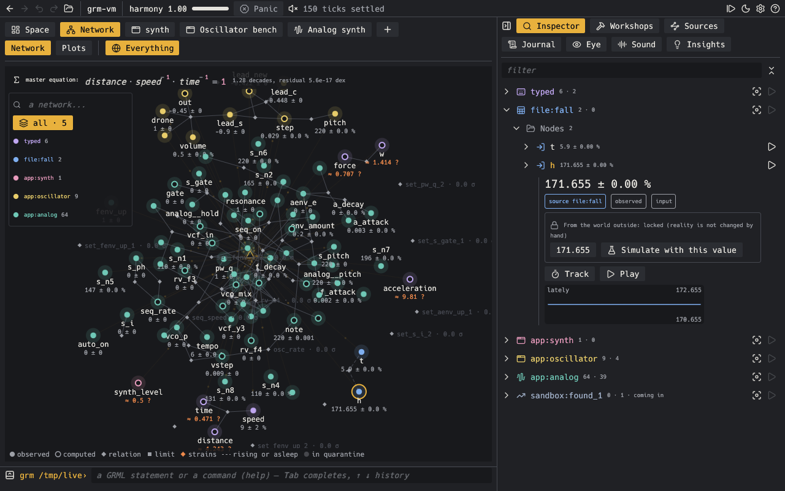

## What this is, in a few words

**grm-vm is a machine that holds what is known as a network of numbers and of the relations between them, and
that says, for everything it holds, how sure it is.**

You tell it things: *a mass is 2 kg*, *a force is a mass times an acceleration*, *here is a table of measurements*.
It puts each one in the network as a node (a quantity) or a relation (an equation, a law, a constraint), and the
network settles by itself: every value is computed from all the others at once, each with its uncertainty
(`9.81 ± 0.02`), and where things disagree it shows the strain instead of hiding it. Give it data and it looks for
the laws in it by itself (in a table of a falling body it finds `h = 4.9 · t²`), forecasts with how sure it is,
and tells why it believes what it believes: which relation said what, and how much each one weighed.

Nothing is hidden: it is AI in an open box. Every number can be clicked, every relation read as an equation (and
copied as LaTeX), every change taken back, every source put in quarantine.

On top of it, you build **apps**: small programs written in its language (GRML), each one at once a network, a
surface (sliders, keys, plots, scopes) and code, all three changed while it runs. It also makes sound: any node
can be played, computed 48 000 times a second.

### Why

- **One model for everything**: physics, data, music, the layout of its own window. They all live in one global
  network, so anything can be linked to anything.
- **Honest numbers**: an answer always comes with how sure it is, and with where it comes from.
- **Safe by construction**: what is new is tried apart first (sandboxes, workshops), merged little by little, and
  put in quarantine when it breaks the harmony of what is known.
- **Calm**: nothing flashes, nothing jumps; accessibility (screen readers, sizes, contrast) from the start.

### How it works, in one paragraph

Each node holds a belief (a value and a precision); each relation is a factor that sends its neighbours what it
thinks they should be (Gaussian belief propagation). Products and powers are straight lines in logarithms, so most
laws of physics are linear there and solved exactly. A node or a relation only works when a neighbour has
something new to say: a network at rest costs nothing. The machine comes from a Python proof of concept,
[grm-core](https://github.com/innermost47/grm-core), and gives the same numbers.

### What is in this repository

The engine (Rust), a prompt (`grm`), a window (`grm-app`, built with egui), the sound (cpal), connections (files,
tables, HTTP, WebSocket), and a few apps. It is a first version, moving fast: what it does not do yet is listed at
the end, honestly.

Licence: AGPL-3.0-or-later. © 2026 Anthony Charretier. The icons are [Lucide](https://lucide.dev)'s (ISC licence,
`assets/icons/LICENSE-lucide`).

## Build and run

```sh
cargo build --release
./target/release/grm               # a prompt
./target/release/grm program.grm   # says the file, then gives the prompt
./target/release/grm-app           # the window (same commands, same memory)
cargo test                         # everything, the parity with the Python machine included
```

The window has tests of its own (`crates/grm-app/src/ui_tests.rs`, with egui_kittest): the whole window, opened in
a home of its own (`--home DIR`: its world, its settings, its apps and her mind copied there) with no sound card
(`--headless`), clicked and typed into by the words of its buttons, closed and opened again. Every bug fixed in the
window is played again there. The rules the project keeps are in `CLAUDE.md`.

The look of everything comes from one file, `style/style.grm`: its fonts (IBM Plex Sans; Courier Prime for the
code only; both SIL Open Font License, in `assets/fonts`), five sizes of text, its corners, the room inside things,
its colours, and its variants (`variant day from night`).

Widgets hold widgets, as networks hold relations, and kinds of one's own are made as networks are:

```
kind strip(ch): card "{ch}"
  widget gain: knob {ch}_gain 0 .. 1 tip "how loud"
  widget pan: knob {ch}_pan -1 .. 1
end
widget mixer: row at 0 0 size 8 6
  widget t1: strip(ch=t1)
  widget t2: strip(ch=t2) when t2_on
end
```

`row`, `column`, `grid N`, `stack`, `scroll`, `tabs`, `card` hold others; every widget can say `tip "words"` and
`when NODE`. `choice NODE "a|b|c"` and `field NODE` (a number written with a comma or a point) are written as the
others are.

On Linux, the sound needs ALSA's development files to build (`libasound2-dev` on Debian and Ubuntu); the window
needs nothing more than a graphics driver (OpenGL).

At the prompt: the language (GRML, as in grm-core: `node`, `relate`, `keep`, `observe`, `forget`, `var`, `set`,
`learn`, `input`, `output`, `fuse`, `network ... end`, `call`, `use`), and `help` for the rest.

```
grm> node x signed
grm> relate r: y = 2 * x
grm> observe x = 1 ± 0.001
grm> sandbox idea
grm> in idea: relate lie: y = 10 * x
grm> trial idea
  merge of idea: 0 new node(s), 1 new relation(s)
  harmony 1.000 -> 0.665
  surprise x: moved 1000.0 sigma
  surprising: it would need to be confirmed (not rejected)
grm> merge idea
grm> tick
grm> status
  ⚠ in quarantine: sandbox:idea
```

## What is in it

| | file | |
|---|---|---|
| the language | `lang.rs` | GRML, statement by statement, as grm-core reads it |
| the network | `network.rs` | nodes, relations, measurements; each with its **provenance** (who said it, from where) and its **strength** |
| the machine | `machine.rs` | belief propagation: rounds, ticks, `set`s, learning |
| the world | `world.rs` | the global network, **sandboxes**, **trial merges**, **integration little by little**, **quarantine**, **recall**, `remove`, the logbook |
| the engine | `engine.rs` | the machine in a thread of its own, computing a frame at a time, publishing snapshots |
| ports | `ports.rs` | what comes in and goes out: values, vectors, events (a click, a key), images and sounds (their adapters come with the senses) |
| clocks | `reflex.rs` | the speed of sound: a network's `set`s run directly, 48 000 times a second, tuned by the machine above |
| peers | `peers.rs` | machines that share what they believe, never their data, without a centre |
| hidden state | `hidden.rs` | what a node really is behind what is measured of it: a Kalman filter that follows it, an expectation-maximisation that consolidates its law, the world's noise told from the senses' |
| time | `time.rs` | nodes that **remember** (precise near the present, coarser further back), **learn how they move** in real time, **find links by themselves**, are **foreseen** with a confidence, and say **why** |
| the world outside | `grm-connect` | web APIs: what an answer can give (fields, kinds, units), the chosen fields into a sandbox, their rows each at its moment; Open-Meteo and Our World in Data to begin with |
| laws | `discover.rs` | what holds between nodes at the same moment (a line, a power, a product of powers), found in the rows it has seen and proposed through a sandbox |
| the eye | `vision.rs` | pictures: a network of its own near what it sees (pixels tied to their neighbours, a pyramid above them), that cleans, fills, keeps edges, is surprised, sees what changed, and sends a glance to the world's network |
| units | `units.rs` | a node with a dimension is given in SI, counted inside in Planck units |
| the prompt | `grm-shell` | every command, the same in the terminal and in the window: a line goes in, lines come out (said, dim, a warning, an error, a question waiting for y/n) |
| the sound | `grm-sound` | the machine's own voice, the mixer of the human's channels, the sound device, WAV files |
| the window | `grm-app` | the network, the prompt, the inspector, sandboxes, sources, journal, eye, sound; apps as code, network and surface; placed by a GRM network |
| apps | `grm-shell` (`apps.rs`, `runtime.rs`) | an app's file read (`use` and `call` unfolded, its surface and APIs set apart), run, edited while it runs, closed, kept with the desk |
| APIs | `grm-connect` (`api.rs`) | GET every so often, POST, WebSocket, each in its thread, what it reads into nodes |

### Never waiting, never computing for nothing

- **A round is shared out between threads** when there is enough to do, and gives the same numbers on 1 thread or
  32: each processor reads only what the round before wrote (tested bit for bit).
- **Only what moves is computed.** A processor that hears nothing new does nothing. A measurement wakes its node
  only. A network that grows (a relation added, a file said) goes on from where it was: only what is new is woken
  (adding one relation at the end of a chain of 300 costs a few messages, not the chain again).
- **Anytime.** The engine computes at most a frame (8 ms by default), then publishes where it has got to: what is
  shown is usable even before it has settled. A capped round (`Budget`) takes the biggest news first.
- **Nobody waits for the engine.** Whoever talks to it sends orders and reads snapshots.

### Trying apart, merging carefully: the beginnings of an immune system

- **A sandbox** is a network of its own. It reads the global network's beliefs at its border as fixed
  measurements, and computes only itself; the global network does not know it is there.
- **A trial merge** puts it into a working copy of the global network (starting from where the global machine is)
  and reports: new nodes and relations, what it would replace, names said differently, the relations that would
  hold less well, the harmony before and after, the nodes it would move further than 3 sigma. Something
  surprising is not rejected: it is said to need confirming.
- **Merging is gradual**: the new relations rise in strength (10 %, 25 %, 50 %, 75 %, 100 %), one step a tick.
- **Quarantine**: if the harmony falls (the relations, and what the world was measured to be) or a surprise
  rises while they rise, they go back to 0. They stay visible until released or recalled.
- **What a source taught can be taken back**: the weights keep what they learned by source; a quarantine or a
  recall takes it back.
- **Recall**: everything that came from a source, taken away at once, everywhere (what others still hold stays).

### Machines without a centre

Two machines that share nodes exchange messages about them (a precision and a mean): never their data. What a
machine tells a peer leaves out what it heard from it (nobody counted twice). What a peer says comes in as a node
of its own, tied by a relation of the peer's provenance, its certainty capped by the trust it has: a peer can be
put in quarantine or recalled like any source. The transport here is in-process; the internet's comes later,
with the same messages.

### Time: remembering, learning, foreseeing

- **Memory**: the last moments one by one, then spans twice as long, again and again (a memory that grows with
  the logarithm of time, each span with its mean and its spread; inspired by the scale-invariant memory of time,
  Shankar and Howard 2012). `rewind` reads it back.
- **A law of motion learned in real time**: its next value from its last ones (two lags: it can swing, with its
  period and its damping), from the nodes it is coupled to, and a constant; a Bayesian regression that forgets
  slowly, so it follows a world that changes.
- **Links found by itself**: shadow laws try the couplings a node does not have; one that predicts what comes
  clearly better (e^6 of evidence, measured before seeing each moment) becomes part of its law, and the logbook
  says so. A link that predicts is not yet a cause.
- **A hidden state**: once it has seen 64 moments, a node learns what it really is behind what is measured of
  it: the world moves (`x_t = a . x_past + b . u + c + w`), and is measured with an error (`y_t = x_t + v`). A
  Kalman filter follows it moment after moment (a missing measurement: it goes on, less sure); every 24 moments
  it consolidates its law, the world's noise and its senses' noise on the 480 moments it keeps one by one
  (expectation-maximisation with a Kalman smoother, Shumway and Stoffer 1982). A law that would blow up is
  brought back inside. On a swing read by a poor thermometer, its 24-moment forecasts are three times narrower
  than a law learned straight on the measurements, and still hold the truth.
- **Cycles found by themselves**: shadow laws also try the rhythms its past seems to hold (the strongest peak of
  its periodogram, and a day and a week when it counts in hours). A cycle is a rhythm it is measured with, on top
  of its state (an amplitude and a phase), learned with the rest.
- **Critical thinking**: a link or a cycle found quickly on the measurements is looked at again with the hidden
  state: it must explain what the node remembers clearly better than without it (by half the log of the moments
  per weight it adds, as the Bayesian information criterion asks); at once when it is found, and all its links
  every tenth consolidation. A link that does not pay for itself was an echo of the senses: the node stops
  believing in it, does not try it (or a rhythm close to it) again, and the logbook says so. On the weather, the
  temperature keeps its day; the humidity's day is dropped (it comes through the temperature it follows).
- **Searching afresh**: every tenth consolidation starts again from several points, not only from what it
  believed: a belief can be a dead end.
- **Thinking in parallel**: consolidating and thinking again are the long part; each node does it on its own,
  all at once, on as many cores as there are (the numbers do not depend on them).
- **Foresight**: the tracked nodes run forward together, 300 times, each run drawing a law it could have, where
  it is now, the world's noise and its senses' noise: the spread widens with the horizon.
- **Why**: a confidence (1 minus its uncertainty against how much it usually varies), where its uncertainty comes
  from (the world moving, its senses, its ignorance of its own law, not knowing exactly where it is now), the
  noises it has told apart, what each part of its law contributes, every node and source it
  rests on, and how many of its past forecasts fell within one sigma (does it know how much it knows?).

```
grm> connect meteo 48.86 2.35 30        # (or: connect file answer.json, connect owid co2 France)
grm> take meteo 4 5                     # the fields chosen become sandbox meteo
grm> trial meteo
grm> merge meteo
grm> feed meteo                         # 720 rows, each at its hour; found by itself: humidity follows temperature
grm> forecast temperature_2m 24
grm> why relative_humidity_2m 3
grm> rewind temperature_2m -240         # ten days ago, as remembered
```

### Memory between sessions

The whole world falls asleep in a file and wakes exactly as it was: its network, the state of every processor,
its sandboxes, what is rising and what is in quarantine, its logbook, its rows, its laws, and its nodes that
live in time (their memories, their laws, their hidden states). The prompt wakes from `grm.world` (or
`$GRM_MEMORY`) when it starts and falls asleep there when it quits; `sleep FILE`, `wake FILE`, `forget everything`.
A world put to sleep and woken goes on with the same numbers, to the last bit (tested).

The desk sleeps beside it: the apps that run and their own copies (`grm.desk.json`), the APIs said at the prompt,
what played and how, the machine's voice; and the window as it was left (`grm.window.json`): which app is shown
and how (code, network, app, launched, edited, x-rayed), the side panel's tab, the selection, where every point of
the network was put and how the view was moved, the panels' wishes, the log and the prompt's history. The world
is also put to sleep every minute while the window is open, and when it closes (Ctrl+Q).

### Laws at the same moment

The rows it measures are kept evenly along what it lived (400 at most: when there are too many, one in two is
let go). After a file, and on `discover`, it looks for what holds between its columns on every row (r² ≥ 0.999),
the simplest form first: `y = a x + b`; else the best of `y = k x^p`, `y = a ln(x) + b` (the Hubble law, in
magnitudes) and `y = k e^(a x)` (a decay); for what no single node explains, sums `y = a1 x1 + a2 x2 [+ a3 x3] + b`
and products of powers `y = k x1^p1 x2^p2 [x3^p3]` of two, then three nodes (the fewest that hold, each of them
counting); and two straight lines in two regimes of a third node (`when z in lo .. hi`, the value
where it changes searched among all). A law that needs a logarithm says the nodes that hold it. Coefficients are
written to twelve digits, and a law is never held surer than that (a law rounded and held exactly would
contradict the same law said the other way). Each law is written in its language (with its spread as its
sigma) and proposed through a sandbox: a compatible one is merged little by little; a surprising one waits in its
sandbox for a human.

### A value missing

A value missing from a row is no measurement. A node that lives in time is then given what it expected (its
forecast and its spread) as a soft measurement, so its relations still hear of it; it is never remembered as
measured.

### The machine following a node itself

`embody NODE`: the machine holds a node's hidden law as its own relations: its state, its states before (carried
from tick to tick together, with their uncertainty and how they move together: `carry x = y` and
`carry a, b = c, d`, new statements of the language), its law (the world's
noise as its sigma), and how it is measured (its rhythms, its senses' noise). The machine then follows the node
as a Kalman filter does, with every other relation of the network heard at once, and foresees the moments not
measured. On a world read by a thermometer erring by ± 0.5, what the machine believes is within ± 0.29 of the
truth. The law is held again each time it is consolidated.

### Believing together

`joint NAME...` (or a vector's name): what the network believes of several nodes together, as one Gaussian of
several dimensions: each value with its exact sigma, and how they move together. It is computed from the whole
network at once (its information matrix, drawn straight where it stands, solved by conjugate gradients): two
unknowns whose sum is known move against each other (-0.99), as they should.

### Beliefs held together

`carry a, b = c, d`: at each tick, what the network believes of c and d together (their means and their
covariance, computed from the whole network) becomes one prior over a and b: a state of several parts carried as
one. `observe v = [1, 2] cov [[1, 0.9], [0.9, 1]]`: a vector measured together; measuring one of its components
then moves the others with it. Such beliefs are factors of the machine over several nodes: belief propagation
carries what they say to each node.

### The eye

*The eye is put away from the window and the prompt until a real vision module comes (it brought too little as it
was); the engine keeps it (`vision.rs`) as described here.* An eye sees a picture (grey or colour). It is a network of its own, as a retina is: every
pixel a node, tied to its neighbours ("I look like the one beside me, more or less"), and a pyramid above them
up to a glance of 8 x 8 nodes. It computes near what it sees and sends on only what is worth it:

- **cleaned**: its noise taken away, its missing pixels filled, its edges kept (a neighbour that differs much is
  believed less and less: robust weights, drawn again three times);
- **surprised**: at each pixel, how far what came is from what the rest of the eye said it would be, in sigmas
  (the message belief propagation already sends the pixel);
- **what changed** since the last picture, in sigmas;
- **a glance**: the top of its pyramid, heard by the world's network as inputs `NAME_glance_x_y`.

Pictures are written beside the one seen (`-clean`, `-surprise`, `-change`). An image port feeds an eye too.

In the window, the Eye tab says what it does in four signs (a picture comes in; it is cleaned; what surprises it
is shown; its glance goes to the network). Several pictures are chosen at once, each seen by an eye named after its
file, with a slow wheel while it works; the path goes once a picture is seen. A picture clicked opens large, and the
arrows go from one to the next through every eye (a carousel); a double click on an eye in the network does the same.


On a 48 x 48 picture with noise of ± 0.10 and 15 % of its pixels missing, what the eye sees is within ± 0.028 of
the truth, the missing pixels within ± 0.04, and the edges stay sharp; a 64 x 64 picture takes half a second on
the machine it was written on, a 256 x 256 one about 7 seconds. Recognising what is in a picture is another step (features learned), not this one.

### The window

`grm-app` shows the machine as it is, and every button is a line said to the prompt (it shows in the log: nothing
happens behind the human's back).

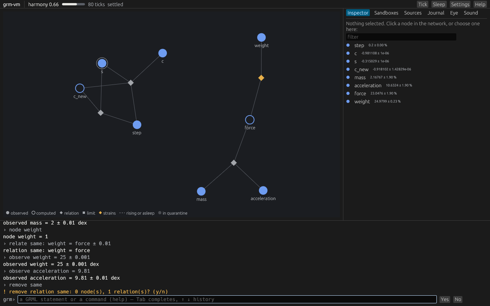

- **The network**: nodes (circles: filled when observed, hollow when the network computes them) and relations
  (diamonds; squares for limits), linked as the machine holds them. A colour per source (kept when others come or
  go); amber for a relation that strains (never red); faded for what is in quarantine; dashed for what rises little
  by little or sleeps. An eye's glance is one point. Click to inspect, Ctrl+click to add, Shift+drag a box, drag a
  node to put it somewhere, wheel to zoom, drag the background to move, right click for what can be done. It moves
  slowly, and stops when it is at rest.
- **The prompt**: history (↑ ↓), completion (Tab: commands, nodes, sources), Yes / No when it asks. In French,
  the machine's usual answers are said in French in the window (the others stay in English).
- **The inspector**: value ± sigma (a positive node's spread as a percentage), where it comes from, what it is
  (observed, computed, fixed, written by its sets, learned, an input, an output, in time), its relations with their
  strain; for a node in time, its memory and what it will be (a line, its spread, the forecast dashed with its sigma
  and the range of its draws), and why. Several nodes: what the network believes of them together.
- **Sandboxes** (say in it, run, trial, merge, refuse), **sources** (quarantine, release, recall), the **journal**,
  the **eye** (what it saw: cleaned, surprised, what changed), the **sound** (its voice, the channels).
- **Accessible and calm**: everything by the keyboard (Ctrl+L the prompt, Esc, F1 help, Ctrl+1 … 6 the tabs, Ctrl+.
  panic), screen readers through AccessKit, text size, dark or light theme, French or English; nothing flashes,
  what changes glides, and the window repaints only while something moves. (The machine itself still answers in
  English: its messages come from the engine.)
- **Placed by relations**: the panels are nodes of a small GRM network of their own. The window's size comes in as
  two inputs; soft wishes (`side = 0.3 * W ± 0.03`) and limits (`keep side >= 300`) decide; dragging an edge adds a
  wish, stronger than the share, still within the limits; a narrow window switches regime (`when W in 0 .. 860`)
  and the side panel goes under the network. The settings show its statements and its harmony.


`grm-app --fresh --script LINES.txt --select a,b --tab sound --size 1280x800 --theme light --lang fr --screenshot
OUT.png` says the lines, takes a picture of the window and closes (to test it without anyone in front of it).
The drawing is behind the model (`model.rs`, `graph.rs`, `layout.rs` know nothing of egui): the renderer can
change without touching them.

### Apps: what the human builds on it

An app is one file of the language: its network, its surface, its APIs, the commands it runs when it opens.

```
app Oscillator bench
input pitch = 220 positive
input volume = 0.5 positive
input hold = 0
node step = 0.0288
relate turn_rate: step = 0.000130899693899575 * pitch
use networks/osc.grm                      # networks written once, used by many apps
call osc(name=lead, step=step)
node out signed
relate loudness: out = volume * lead_s + volume * hold * lead_s
widget p: slider pitch 55 .. 880 at 0 1 size 6 1 "pitch (Hz)"
widget go: play out at 0 2 size 3 1 "sound"
widget wave: scope out -1 .. 1 at 3 2 size 9 3 "the wave"
widget kb: keys pitch hold at 0 5 size 12 2
```

- **Three views of one thing**: its code (coloured, its line numbers, the lines it could not say in amber with
  why), its network (only what it holds and the nodes it touches), its surface. A change in one is at once in the
  others: there is no build. Each change is said again into the running app in one step (nothing in between is
  ever seen), it goes on from where it was (what its `set`s write, its variables, its inputs keep their values),
  what it plays goes on without a click, and the file is written at once. Undo, redo.
- **The surface**: widgets on a grid of 12 columns (the width is shared, whatever the window): `slider`, `toggle`,
  `button` (1 while held), `meter`, `value` (± sigma), `plot` (through time, with its spread), `text`, `picture`
  (what an eye saw), `pad` (two nodes at once), `keys` (a keyboard of notes: the frequency, and 1 while held; the
  computer's keys A W S E D F T G Y H U J K play it too), `play` (plays a node, stops it), `scope` (what a node
  that plays sounds like). A widget that touches measures its node; a widget that shows reads its value and spread.
- **Edit mode** (Ctrl+E, a button, also when launched): the app keeps running and sounding while its widgets are
  moved and sized (snapped to the grid; a widget never goes over another), chosen to change their line, added
  (kind, nodes, name), taken away. Made to be used live, on stage.
- **X-ray** (Ctrl+R): over each widget, its line in the file, the node it is bound to, its value ± sigma and where
  it comes from. Nothing of what an app does is hidden from who uses it.
- **Its network, by hand**: drag with the right button (or Alt) from a node to another: a relation, written first
  in a small window, then added to the app's file. A relation an app writes can be edited from the inspector
  (its line). `remove` of something an app writes asks, and takes the line from the app's file.
- **Launch** (F5): the app alone in the window. Esc: back.
- **Several networks, shared**: `network NAME(p, q) ... end` in a file, `use FILE`, `call NAME(p=..)`: unfolded
  into plain statements, so every name the machine holds is written somewhere. Two apps can use the same network:
  while only one runs, it holds it; when a second one opens while the first runs, the second runs its own copy
  (its names given its prefix, `synth__lead_s`), said in the log and in its bar.
- **Nothing forgotten by the machine**: what an app holds is never taken away by the machine itself; `remove`,
  `recall` and `quarantine` of it ask first. Closing an app (`app close NAME`, or its tab's menu) keeps its file
  and what it was living through, for when it opens again.
- **`clock S`**: the world ticks every S seconds while the app runs (the shortest asked wins).
- Apps are the `.grm` files of `apps/` beside the world's memory (or `$GRM_APPS`); `+` in the tabs opens one or
  makes a new one; `apps`, `app open|new|close|undo|redo NAME` at the prompt. Three come with it: the studio (see
  below), the weather of Lyon (an API every ten minutes, a relation to Fahrenheit,
  a plot), a swing in time (a clock, a node tracked: its memory, its forecast, why).


### Seeing it work

- **The master equation**, top left of the network: what the relations of products say together once every node
  in between is eliminated (in log, a chain of straight lines; what is left links the nodes at its ends), with how
  many decades its nodes span and how far it is from holding. Under it, the one of what is shown (an app, a network
  brought to the front). Nobody wrote it: the network holds it. `master [SOURCE]` at the prompt.
- **Under the pointer**, a node or a relation says everything: its value ± sigma, where it comes from, what it is,
  its relations or its equation, and its curve as it moves now (a node that plays: its wave, as it sounds).
- **Right click**: what can be done, each with its sign and a line saying what it does (inspect, follow in time,
  forecast, play, plot, relate to…, edit its line, quarantine its source, remove; on the background: a new node by a
  small form — its name, its kind, its value — written in the code of the app shown, a new relation, fit, plots).
- **The networks in the network**: a chip each above the view (`typed`, an app, a file, a sandbox), a soft halo
  of its colour around its nodes; a chip brings it to the front (`focus NAME`).
- **Plots** (desk or app): the nodes through time (one track each, never two scales on one axis), one against
  another, a path (a phase), their values now with their spread.
- **A sandbox shown** in the middle, as a network of its own (Sandboxes → Show), with run, trial, merge, refuse.
- **The code beside** (`</> code beside`, Ctrl+K): an app's code docked right, left, top or bottom while its network
  or its surface is shown; a line typed appears in the network, a node made by the mouse appears in the code.
- **The guided visit** (`tour`, or the help): one part of the window lit at a time, the rest dimmed; it comes by
  itself the first time.


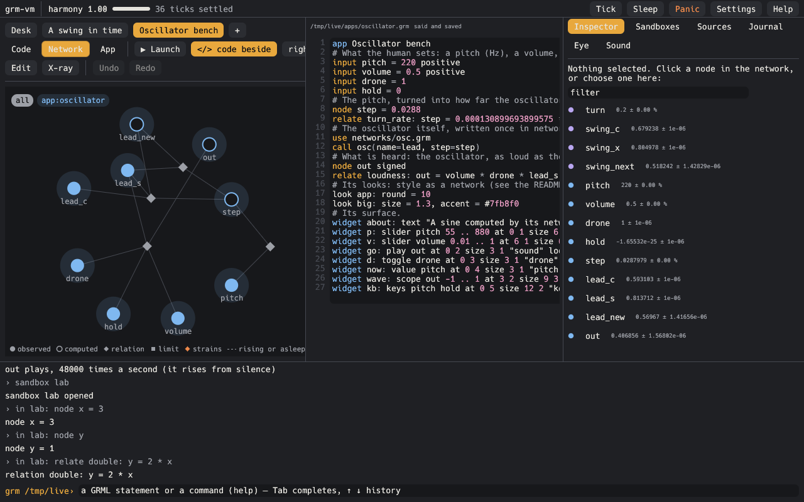
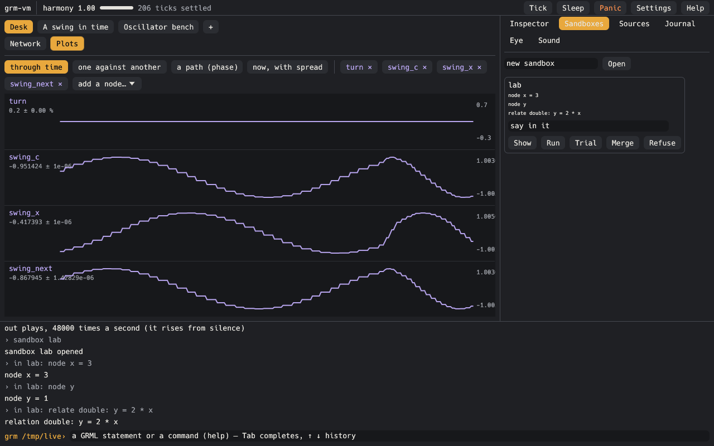

### The machine's look

A palette (night, day, ocean, contrast, or each colour by hand in the settings: background, panels, buttons, text,
quiet text, accent, strain), a typewriter font everywhere if wished (on by default), the machine's name in block
letters when it wakes, a taskbar icon. Apps inherit it.

**Looks: style as a network, not as classes.** An app says `look NAME: accent = #7fb8f0, background = .., text =
.., round = 10, size = 1.3 [when NODE in LO .. HI]` and a widget wears it (`widget go: play out look big`). Each
property is a node of a small GRM network of its own: the machine's palette is measured into `vm_*`; the app's look
(`app_*`) is held to it, and each named look to the app's, by soft relations, each parent held a hundred times more
surely than its child (so the cascade goes one way); what a look says holds at ± 0.0001, so it wins; what it does
not say is inherited. A look with `when` holds only while its condition does; the hour comes in as an input, and
with "follow the hour" the evening warms the accent and dims the background (relations, not code). `style
STATEMENT` says anything of the language into that network (`style relate breathe: big_size = 1 + 0.2 * warmth`).

### Getting around, and taking back

- **Back and forward**, as in a browser (the arrows top left, Alt+Left / Alt+Right, the mouse's side buttons): the
  places the human has been (the desk or an app, in which view; a file; a sandbox; what was selected; the side tab;
  where the view looked).
- **One undo for everything** (Ctrl+Z, Ctrl+Shift+Z or Ctrl+Y, or the arrows top left): the world (the prompt keeps
  it as it was before each change), an app's text, an app opened or closed, where the nodes were put, the settings,
  a table's cells and its rows and columns. One list, in the order the changes were made, shown in the journal
  (what can be taken back, and what was and can be given again). While words are written in a field, Ctrl+Z is the
  field's own.
- **Files dropped on the window** are opened as what they are: an app runs,
  a table opens as a table, any other text opens to write; a folder becomes where the machine works. Or **Ctrl+O**
  (the folder sign): the system's own window to choose them (where the desktop has a file portal; otherwise it
  says so).
- **The inspector is an accordion**: every node a line; a click unfolds what it is in place (several can be open);
  a node chosen in the network unfolds there, and the list goes to it.
- **The prompt is coloured** as code is, as it is typed and in what was said.
- **Signs, never emoji**: every sign is a Lucide icon, drawn and tinted with the palette; an app wears one
  (`icon audio-waveform` in its file, any of the 2 359).
- **A new app**: + then *New app*: its name, Enter. Right click on an app's tab: launch it, close it, or put it in
  the **trash** (`app trash NAME`; it comes back with `app restore NAME`, from the Sources tab, or by Ctrl+Z).
- **The side folds** into a rail of signs, and opens again on the tab whose sign is clicked; its width is the
  human's (drag its edge), and it goes down to the bottom of the window. **The prompt folds** to its one line.
  The **panic** button is always at the top, beside the harmony.
- **What goes wrong is said softly** in a corner for a few seconds (it blocks nothing, comes and goes slowly, can
  be closed), and kept in the prompt's lines.
- **Paths with spaces** are said between quotes (dropped or chosen files are quoted by the window); typed without
  quotes, words that together name a file that exists are one (`load C:\Données\relevés 2026.csv`).
- **Two tables with the same column names**: before their data would be mixed in the same nodes, the window
  proposes other names (`load FILE COLUMN=NODE`, or `--mix` to mix them on purpose).
- The code beside **wraps** its long lines (each number stays on its line's first row); fields have room inside
  and what they wait for is written in italics.


### The space: a table, not a desk

The first tab is a **space**: an infinite table (drag the background to move around, Ctrl and the wheel or two
fingers to zoom) where the human puts what they want, in their own order or their own mess, and a button tidies
it. On it: **apps** (an app and a widget are the same thing: small on the table it is a widget, bigger a window,
double clicked it opens whole), **networks** (each looked at its own way), files, plots, what the machine feels, a
clock. Several apps live side by side and play at once. A frame moves by its title and grows by its corner.

**The space is itself a file**, `space.grm` beside the memory, one line per thing on the table
(`place app weather at 40 60 size 420 300`): *Its code* opens it, and what is written there is what is shown.

**Every zone is four things**: small on the space, in place of the space, the whole screen, or a window of its
own (a real window of the system, to put on another screen). Its signs are on its title; a double click inside a
frame brings it in place of the space; Escape or closing its window puts it back on the table.

The machine's voice (the wind, the pad) is turned on or off from anywhere: the speaker at the top, or Ctrl+M.


### The inspector as a tree, formulas as mathematics, from the large to the small

- **The inspector is a tree**, browsed as a file explorer: the networks (each with its sign: an app's own, a
  keyboard for what was typed, a table for a file...), then their nodes and their relations in two folders, then
  what each holds (a node's relations, a relation's nodes). Every line can do two things: **show its detail**
  (a click: for a network, its master equation and its curve, what it brings and what its links cost; for a node,
  its value, what it is, its curve, its actions; for a relation, its formula, its strain, its worth) and **unfold
  its children** (the chevron). Every line has its sound (play, which becomes stop while it is heard; a network
  plays its outputs) and, under the right button, what can be done with it. A relation clicked in the network
  opens there too.
- **Formulas are drawn as mathematics** (fractions, powers, functions), in the inspector, under the pointer and in
  the master equation; a right click (or a double click) **copies them as LaTeX**
  (`\mathrm{force} = \mathrm{mass} \cdot \mathrm{acceleration}`).
- **A master equation has its curve**: its first node along, its second as it follows (the others held where they
  are), in log on both sides (a power law is a straight line), and where the network is now.
- **From the infinitely large to the small**: zooming out, the networks gather, each into one node (its size, its
  colour, the relations that join it to others as thick as how many); a double click on one (or on any node, or
  *Go into it* in the tree) goes into it, and only it fills the view. *Everything* (or Alt+Left) comes back out.

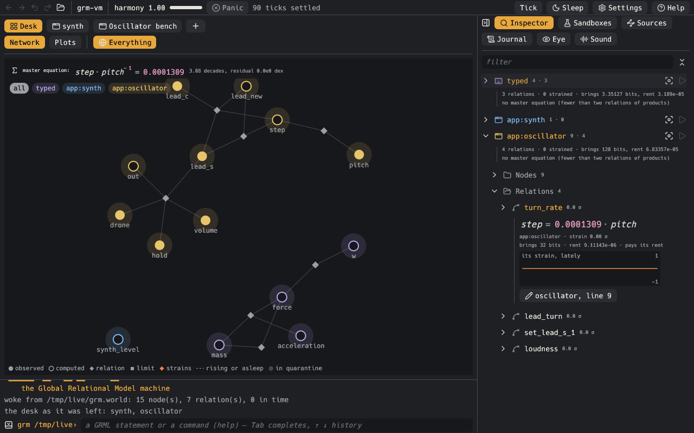
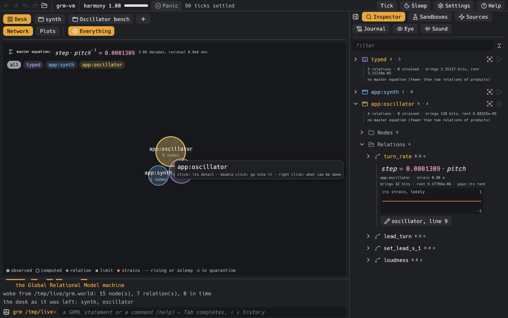

### What it feels

Ported from the Python machine's mind, and shown in the journal, as quantities and as curves:
**pleasure and displeasure** (the dopamine neurons signal the difference between what was expected and what came:
the machine expects a certain surprise from its inputs, and being less surprised than it expected is pleasure,
more is displeasure; finding something by itself, or taking in what it tried apart, is a burst of pleasure; what it
has to put in quarantine or refuse, a burst of displeasure; with nothing new, it comes back to rest),
**flourishing** (accuracy, its inputs no longer surprising it, times room, the links it can still hold) and
**progress** (how much its surprise is falling: what it is learning now). What the human does is a signal too
(taking something back is a little displeasure, giving it again a little pleasure), and every moment that moved it
is written with why. Nothing of it leaves the machine.

**Living colours** (on by default, a switch in the settings): a slow breath through the palette (a few degrees of
hue, a hundredth of light, over half a minute and more; never a flash), the sound lifting the accent a little.


### The world, from Our World in Data

*Let the world come* (in the Workshops tab), or `world PLACE` (`monde`): twelve public indicators of Our World in
Data, in six categories (health, people, economy, energy, climate, knowledge), for a place (`World` by default, or
a country by its English name: `France`, `Germany`...). Each category is learned in a workshop of its own
(`world_health`, `world_climate`...), year by year, its source said beside each node; what ties the categories is
for her to find (and to let into the main network through the airlock). The tables are kept a week beside the
memory, and read from there offline.

### An analogue synthesiser, every module a network

*The apps Analog synth, Her synth and Oscillator of before are gone: the studio holds all of it (its synthesiser
is the same, as one network). What follows tells how it was built, module by module.*

The *Analog synth* app is written in GRML from end to end, nothing ready-made: a saw and a square
(`networks/saw.grm`, `square.grm`), a filter of four poles with its resonance (`ladder.grm`), an envelope
(`envelope.grm`), an amplifier, an **echo** (`echo.grm`: one delay and one relation) and a **reverb**
(`reverb.grm`: four delays feeding each other through a mixing that keeps the energy, a feedback delay network),
and a **sequencer** of eight steps, a network apart that drives it instead of the keys (`sequencer.grm`).

One new word made it possible: `delay NAME = SOURCE by SECONDS` (`by 300ms`), a node that is what its source was so
long ago, exact to the sample at the speed of sound. An equaliser, a compressor, a limiter are the same brick with
gains and relations: effects the human writes.


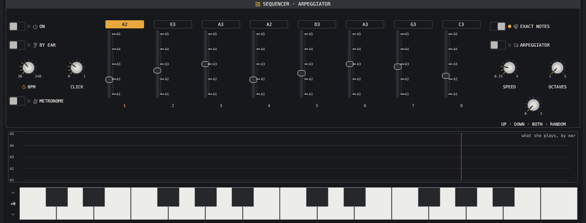

### A node in hand, a simulation, insights

A node clicked can be moved by hand (a slider and a field: in the inspector, or under a workshop's network): the
network settles at once and what follows from it moves. A node that comes from outside (a table, Our World in Data,
an API) is locked: reality is not changed by hand. It can be **simulated**: a copy of its network, apart, where it
takes the value asked; what would move is shown before -> after with its spread, and the simulation is written to a
`.grm` file to be shared. A relation has no direction, so a simulation shows what would go with the value (its
causes as well as its consequences); links learned in time say what comes after.

The **Insights** tab holds three layers: *reality* (what came, from where, locked or in hand), *the reflection*
(where it strains, the levers: the nodes holding most of the strain, with how sure each is; what was found; the
simulations), and *what is shared*. Easing a strain is not making the world better: what is better is the human's
to say.

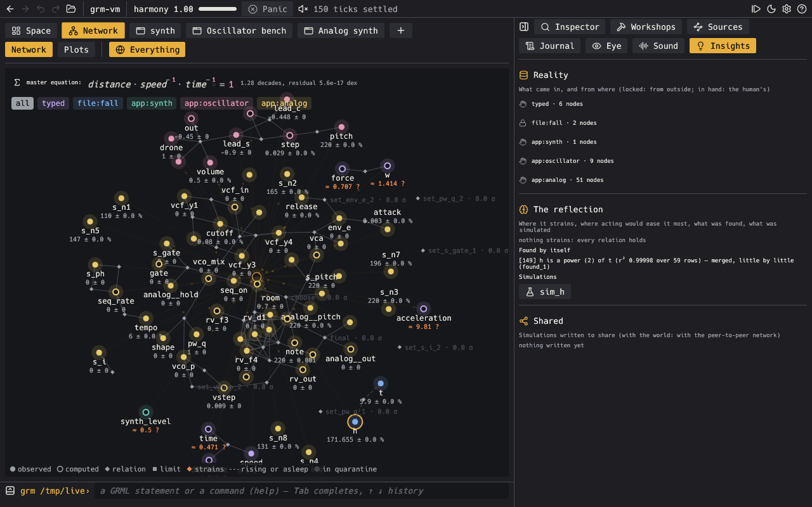

### Improvising by ear

With an instrument's *by ear* switch and its sequencer on, she writes the next notes herself and listens to what
comes out of the speakers' feed: no scale is given. While each note plays she hears how clear the sound is (how
periodic: two notes that agree make one clearer wave, two that clash do not; the echo and the room carry the note
before into the next), and leans towards the intervals that sounded clear, away from those that clashed, a little at
each step. Her taste for each interval is drawn in the Sound tab, as it changes. Her hands are on the knobs too, with
the sequencer or without (the cutoff, the resonance, the envelopes, the echo, the room; not the loudness nor the
metronome's click): now and then she takes one and moves it as a gesture over a few beats, slowly or fast, a little or far (a
sweep of the filter, a room that opens), listens while it moves and a beat after, and leaves it there if it sounded
clearer, or brings it back. What the human plays on
the keys meanwhile, she learns from (each interval played leans her towards it). Over it she plays a **melody**, a
second voice, choosing each note by her taste in time and by what she learned sounds well *with the bass at the same
moment*, holding it for a length she chooses, resting now and then; the sequencer off, she plays the bass herself;
the length of each note and her silences are hers too (a taste for each length and for silence, judged as the notes
are), and the tempo is one of her knobs: only the loudness stays the human's. What she plays is drawn on a **piano
roll** (`widget r: roll`), the bass quieter, the melody in the accent, the last ten seconds sliding slowly to the left;
and with the sequencer or without is hers to decide: no clock tells her when. She keeps what she heard in each way of
playing (how clear, and for how long), weighs both at the end of each of her notes (the way she knows less counting a
little more: it might be better), and changes when the other weighs more.

**What she learned stays.** Her ear, her tastes, her lessons and her mood are kept beside the memory
(`<memory>.music.json`, written every half minute, when she sleeps and when the window closes) and come back the next
time: she does not start again from nothing.

**A richer ear.** She hears how clear the sound is, how bright (its zero crossings) and how loud (its RMS). When the
human turns a knob, she watches and listens: what it did to clarity, brightness and loudness, and where they like it
(their lessons, without words); the same when her own hands turn one. She uses it when she plays: sometimes towards
where the human likes a knob, sometimes the way she knows makes it clearer. On a long note her hands move a knob with
it, slowly, the note's whole length: a **pad** that breathes (the sound and the note together).

**Call and response.** While the human plays the keys she is silent and listens (their notes on the roll in amber);
when they stop, she answers their phrase: its shape kept (its intervals and its rhythm), moved by the interval she
likes best, its last note her own. The keys move by octaves (their buttons, or Z and X). The roll has a **playhead**:
what she has already decided shows after it. The sequencer's *exact notes* switch makes a step moved by hand land on a
semitone.

**Her lessons.** Music taught as a whole, always improvised: the rule says which notes and lengths are allowed, never
which to play. Sixteen lessons: the pentatonic, the major and the minor, the modes (dorian over a modal vamp,
phrygian on a son clave, lydian in 5/4), chords (I-V-vi-IV, ii-V-I in swing, a blues, the andalusian cadence), the
world's scales (hijaz in a 9/8 aksak, bhairav in 7/8, the Japanese *in*, pelog in 12/8, all tempered), the whole tone,
the twelve tones each before any comes back (atonal), and last, nothing but her ears. Each rule is held by a
**bridle** that loosens as what she hears stays at her own level in it (a goal within her reach, step by step; a note
below it is not punished, the bridle simply stays): **guided** (every note on the chord), **accompanied** (the bass
plays the chord's roots under her, she has the scale), **free** (the rule now and then; and she may tune an interval by
its ratio with the bass rather than by the tempered semitone: frequencies, not only notes). In the **studio** she
chooses: towards the lesson where she learns fastest, the ones she knows less counting a little more (Oudeyer and
Kaplan's learning progress); a lesson long below her own level where she does not progress, she leaves *for later*,
without shame. Her **mood** is drawn: pleasure (what she hears against what she usually hears, and the new),
surprise (against what she expected in this lesson), curiosity (how fast she learns), boredom (the same again: its
pleasure fades). Bored and learning nowhere, she rests; when what she lived weighs enough (a pressure that rises with
what is new, as Borbély's sleep pressure does), she asks to sleep, and the world is written.

**Every key, and changing key.** The tonic is hers. She goes through the twelve keys of each lesson by the
circle of fifths: near keys while the bridle is tight (they share all their notes but one), any key when it is loose,
towards the ones she has lived less. She hears the key the human plays in (Krumhansl and Kessler's profiles: how well
each degree was heard to fit a key, by listeners) and, in a lesson, joins it. Three lessons change on their own every
four bars: the **mode** on the same tonic (A major → A dorian), the **key** in the same mode (by a fifth, a fourth, a
semitone, a third...), or **both at once**; guided, each time; free, when she wants it (bored, or for the new). Each
change is judged by what she heard after, and she grows a taste for each move. Four **jazz** lessons go chord to
chord, each chord with its own scale (a minor seventh dorian, a dominant mixolydian, a major seventh ionian, a
half-diminished locrian, an altered dominant the altered scale): ii-V's down by whole tones, rhythm changes, a minor
ii-V-i, and Coltrane's changes by major thirds. The Sound tab draws the circle of fifths, each key lit by how long she
lived it, hers ringed, the human's ringed in amber; and the **comma**: twelve just fifths overshoot seven octaves by
531441/524288 (23.46 cents), so each fifth she walks, tuned just, would carry her 1.955 cents from the tempered key.

**When the sound runs away.** A network that feeds back can run away (the filter did: each of its four poles was a
sample late, and a delay inside a loop that feeds back is a tone of its own, which screamed at full scale from a cut
of 0.1 at full resonance). The filter now has each pole follow the one before as it is now, and holds up to a cut of
about 0.8 at full resonance (the knobs stop below that). And there is a fuse, as an amplifier has: a sample that is
not a number or far beyond a sound starts the network's own values again from nothing (said in a toast); *Start the
sound again* at the top of the Sound tab does it by hand, and *Panic* does it too.

**Every note value, two voices by the rules, lessons that follow one another.** She has every value: a sixteenth,
an eighth of a triplet, an eighth, a dotted eighth, a quarter, a dotted quarter, a half, a dotted half, a whole (a
taste for each). The first lessons hold her to their rhythm strictly (wholes and halves, then quarters, eighths,
dotted notes, triplets, sixteenths, every value in a bar), and the bridle loosens. Two notes together follow the
first rules counterpoint teaches, as tight as the bridle: on a strong beat a consonance with the bass (the unison or
octave, a third, a fifth, a sixth); on a weak beat a dissonance only when reached by step (a passing note); never two
fifths nor two octaves in a row with both voices going the same way; how many notes kept the rules and how many they
moved is shown. Thirty lessons, from the simple to the free; at first they follow one another on their own, each when
the one before is learned (its bridle loose by half); the more she has learned, the freer she is to choose them
herself (*free to choose*, beside her mood). What she lived follows each lesson by its name, so lessons can be added
or moved without her losing anything.

**Four voices, three oscillators, FM.** The synthesiser is one voice (`networks/voice.grm`) called four times, all
sharing the knobs: polyphonic. Each voice has three oscillators: two saws (or squares, by *shape*), the second tuned
by its ratio to the first (an octave, a fifth, a little apart as two strings), and a sine heard on its own and moving
the pitch of the other two as fast as it sounds (*fm*: frequency modulation, and new partials come). The first voice
plays the keys or the sequencer (her bass when she plays), the second her melody, the third and fourth the chords of
her lessons, held a bar each. Each key the human holds takes a voice (several at once: chords), a free one first,
hers when none is (her chords before her melody, her melody before her bass); while a voice is the human's, what she
would play on it waits, and it comes back to her when the key is let go. The computer's keys play by where they are,
not by what they print: the same hand on QWERTY, AZERTY or QWERTZ (the octave under the row: Z X on QWERTY, W X on
AZERTY). The notes sounding are lit, on the roll and on the keys, as long as they last. *Rec* beside *sound* records
everything written while it runs (every note and every knob, by hand or by her) to play it again as it was, and the
notes as a MIDI file.

**Times in seconds, knobs that turn by ratios, a double click.** The envelopes' attack, decay and release are times
(1 ms to 4 s: up is longer, as a musician expects), each becoming the rate it moves at by a relation (rate × time =
1/48 000). A knob whose range spans a hundredfold or more turns by ratios (each turn of the hand counts as much at
the short end as at the long); a knob, a fader or a step double-clicked goes back to where the app first puts it.
The window comes back maximised or full screen, as it was left.

**Two hands, an arpeggiator, lessons on the synthesiser.** Outside the lessons' chords she has a left hand: at each
bar, now and then, a chord of her own over the bass (two tones she likes with it), by a taste for it judged as the
rest is; with the sequencer on, the keys the human holds go to the free voices (the first is the sequencer's). The
**arpeggiator** plays the keys held (or, when she plays, her chord) one after another (up, down, both, at random,
over one to three octaves, so many a step of the sequencer). Six **lessons on the synthesiser itself** (the filter,
the envelopes, the oscillators, the LFO, FM, the effects): guided, she turns each knob of the lesson its whole
course, slowly, listens, and says what it does (*cutoff, turned up: brighter +0.42, clearer -0.05*); looser, she looks
for a sound (a soft pad, a bright lead, a dark bass, a bell, a quiet murmur) by what she learned of each knob, and
says when she found it. Her pace is her mood's: she learns faster when it pleases her and slower when she is bored;
a lesson she enjoys and still finds new, she stays in a little longer; one she is bored of, she leaves sooner (it
comes back later); and when she chooses, the lessons that pleased her count more.

**Tempo in BPM, a metronome, her sense of time.** The tempo is in beats a minute (a step of the sequencer an eighth,
the arpeggiator so many a step). A **metronome** (`networks/metronome.grm`) clicks each beat, the first of the bar
louder; its phase says where the beat is. She hears where her notes begin against it (the nearest sixteenth, in
milliseconds) and places the next nearer the grid as much as her **sense of time** holds; it grows while she plays
with the click. A lesson with a metre turns the click on while it is guided, and off when it loosens: she keeps the
time herself. A gate left open in the memory (a note that would sound for ever) is let go when the window opens, and
by *Start the sound again* and *Panic*. The instrument's nodes are found by the names its file gives them, even when
the window renamed them because another app holds a node of that name (`pitch` became `analog__pitch`: the keys, the
arpeggiator and her notes were going to the other app's node).

**Each their instrument, listening to each other.** *Her synth* (`apps/her_synth.grm`) is the same synthesiser
as the human's, with its own knobs, and it is hers: only she plays it and turns its knobs (the human sees them move;
its loudness and its *by ear* switch stay the human's, its other controls are locked), and she never touches the
human's. She hears both together (her ear listens to everything that sounds), takes the human's phrases, key and
intervals as before, and follows their tempo: one clock for both, the human's metronome. Hers sits a little to the
right in the stereo, the human's a little to the left.

**Drums.** Both synthesisers have a *noise* knob (noise made of nothing but the logistic map x → 3.9999 x (1 − x),
chaotic, in `networks/noise.grm`) and a *to the pitch* knob (the filter's envelope raises the pitch as each note
begins, falling with it): a sine with a fast falling pitch and a short decay is a kick, noise with a short decay a
snare, noise through an open filter with a very short decay a hi-hat.

**The network as a flow.** *Flow*, at the top right of a network view, lays it out from the inputs (knobs, keys,
switches) on the left to what is heard on the right, each node between as far from the inputs as the relations that
make it (a relation reads its right side and writes its left one), the nodes of one voice together, a tall column
folded into several. While it plays, what passes through each node is read from the sound itself, and each link
brightens and thickens with it, slowly; its points are small (the flow is what is seen), and what is heard has
its oscilloscope beside it. A key, a note, a knob written by hand or by her goes straight to the sound
too (not only when the machine next tells it: a short note or an arpeggio was over before it arrived). The piano
roll draws the beat: a line each beat, stronger at each bar, fainter eighths.

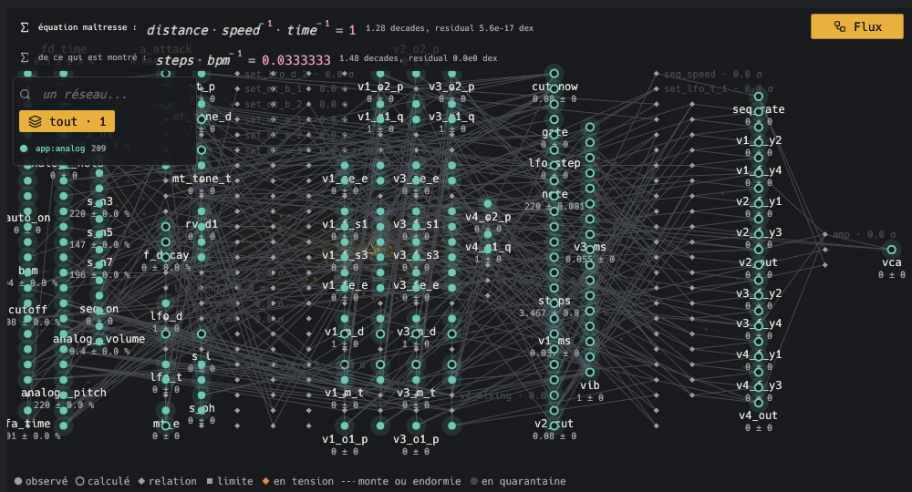

**An LFO.** A slow wave (`networks/lfo.grm`: a triangle whose direction is already a square, bent by 1.5 t - 0.5 t³
into almost a sine) moves the filter (multiplied, so it never closes it below nothing), the pitch (a vibrato) and the
loudness (a tremolo), its speed from 0.05 to 12 Hz, its shape from smooth to square. Its knobs are hers to play too.

**Strict first.** Guided, her leaps are imposed (a third, a fourth, a fifth, a sixth, a seventh, an octave, a
ninth: no wandering by small steps yet), every note agrees with the bass, and her notes fall on the beat whatever her
sense of time; the bridle loosens all three. Two more lessons: *the sequencer* (it runs while the lesson lasts, she
writes its loop) and *the arpeggiator* (its chords one note at a time, its knobs studied). Her surprise is measured
against how far what she hears usually strays, and novelty fades with the time spent in the same lesson and key: the
same again bores her, and her pace (shown, with its reason) slows. The click going on or off is said.

**The mathematics of what she likes.** Each interval is a ratio of frequencies (an octave 2/1, a fifth 3/2, a fourth
4/3, a major third 5/4...); the simpler the ratio (Tenney's height, log2 of p × q), the more the two waves agree. The
Sound tab sets her taste beside each ratio, and how far her taste follows the simple ratios (a correlation): nobody
told her.

**Takes.** *Record* keeps every note (both voices and the human's); *Stop and write* writes a standard MIDI file
(`<memory>.takes/take-001.mid`, the bass on channel 1, the melody on 2, the human on 3) and its notes, which *Play
again* plays on the instrument.

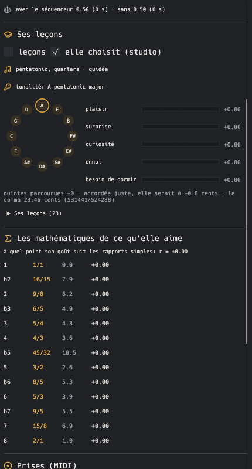

### The studio: one app, instruments, a mixer

*Studio* is one app for the whole song. At the top, sticky, the **transport**: play and stop, the tempo, where it
is (bar and beat), the metronome and its loudness (the human's alone), the echo's time in note values (1/16 to
1/2, dotted ones too), *+ synth*, *+ drums*. In the middle the instruments; at the bottom a **mixer** that scrolls
sideways: a strip per instrument (a meter that rises and falls slowly, its fader, its pan, what it sends to the one
echo and the one reverb they all share, on or off), and the master. One clock for all (`networks/transport.grm`:
sixteenths, bars, the click): every instrument reads it, so they are in time together.

- **A synthesiser** (`networks/synth.grm`) is the analogue one as a single network: four voices, three oscillators,
  the ladder filter, two envelopes, an LFO, glide (portamento; a note held while the pitch moves is legato), a
  sequencer of eight steps each of which can be off, an arpeggiator with *latch*.
- **A drum machine** (`networks/drums.grm`): a kick, a snare, a hat and a tom, each from oscillators and noise (a
  falling pitch, a filtered noise), sixteen steps each, its pitch, its decay, its loudness; a pad for the human to
  hit by hand.

The song (its tracks, its tempo, its echo) is kept beside the memory (`<memory>.studio.json`); the app's file is
written from it (`apps/studio.grm`) each time an instrument comes or goes.

**She is not the instruments: she has hands.** A new word of GRML says which nodes of a tool she may play, and on
which switch the human gives them to her:

```
hand kick when t3_k_hers: t3_k_s1 t3_k_s2 ... t3_k_level t3_k_tune t3_k_decay
```

Every instrument carries its hands (a synthesiser one, each drum of a machine its own), and every app can: what
learns is a word of the language, not a feature of one module. What she holds the human sees move and cannot touch
(until they take it back with its switch). In the studio her synthesiser reads her through a relation: its second
voice plays what her network chooses (below). Her hand on the drums comes back as GRML in the next step.

The space bar plays and stops. A drum machine holds its steps in it, under its knobs: two bars of sixteen (or
one, played again), the step playing framed. The mixer folds like the prompt, and the instruments take its room; a
keyboard given more room has more keys, not wider ones. Her wants are said above their bars (one for each step from
her note, seven semitones down to seven up, and a rest).

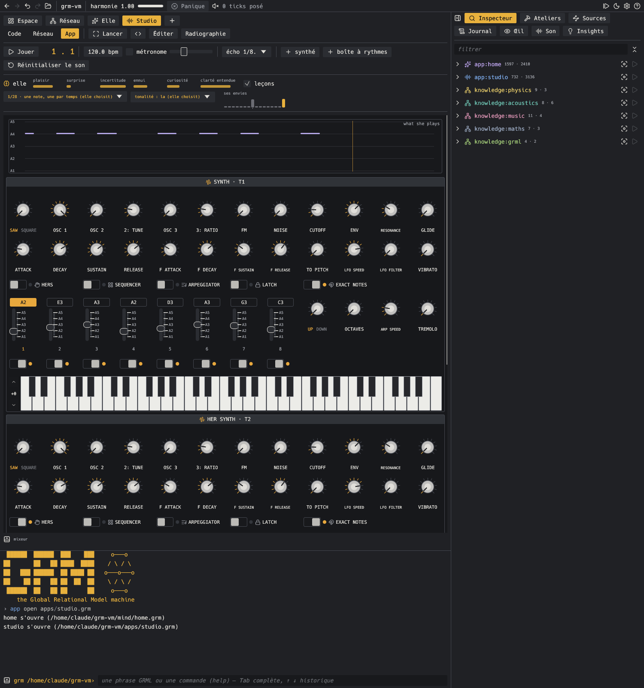

### Her own network: she is GRML now

In the studio she is no longer code of the window: **ELLE** (`mind/elle.grm`) is a network of GRML, called by the
app like any other (`call elle(name=elle, ear=..., clock_i=..., ...)`), the same in every app that calls it. The
window only shows her and carries what she learned from one session to the next. Nothing in her is drawn by
chance: the same network in the same state does the same thing (a test plays her twice and finds the same notes);
what she hears and what she lived change her state, so she never quite does the same thing again. Only her first
weights are made by a formula (her birth). Its parts, from the ear to the hand:

- **The ear**: a cochlea of 36 resonators (state-variable filters), one a semitone from 110 Hz; how clear what she
  hears is (its energy in few places: tones that agree share their harmonics).
- **Expectation**: what usually follows what (intervals counted, the human's and her own, slowly forgotten): how
  uncertain the next is, how surprising what came was (the idea of Pearce's IDyOM).
- **Pleasure**: a surprise when it was certain, or a certainty when it was not (Cheung et al., 2019), and the sound
  growing clearer; the gap from what she expected is what she learns from (Schultz, Dayan and Montague, 1997).
- **A state** of six nodes turning in pairs at their own speeds (as a population of neurons does: Churchland et
  al., 2012), drawn at each eighth towards what she lives; a pair's slope is its other node.
- **Wants**: each choice (fifteen intervals, and a rest) a direction in that state (Georgopoulos, 1986), plus her
  tastes, plus what she learned **in this song and with this human** (each song, each human who plays with her, a
  context of its own: Masse et al., 2018), minus the fatigue of what she just chose, plus the pull of the middle of
  her range.
- **Choosing**: a sweep across her wants, one a sample; the strongest of a sweep is her choice, the one she holds
  kept unless another beats it by a margin (the selection of the basal ganglia: Redgrave, Prescott and Gurney,
  1999).
- **Learning**: after each eighth, what made her last choice moves by the gap of pleasure.

The studio shows her: her pleasure, surprise, uncertainty, boredom, curiosity, the clarity she hears, and her
sixteen wants, the one she holds lit; her notes on the roll. Her synthesiser reads her through a relation (its
second voice is hers when its switch is on): she never writes into the tool.

Three words came into GRML for her, useful everywhere: `repeat k in 1 .. 16: LINE` (a line said for each k, each
`{EXPRESSION}` in it computed: `memory w{k} = {0.25 * sin(k * 2.39)}`), `sum(j in 1 .. 6: w{j} * s{j})` (a sum
written once), and `memory NAME = VALUE` (a variable that keeps what it learned: said again it is not set back,
the fuse of the sound does not clear it).

### The arpeggiator in GRML, the keys that say whose notes they are

The studio's arpeggiator is a network of its own (`networks/arpeggiator.grm`), on the transport's time: the keys
held one after another, up or down, over one to three octaves, a quarter to a thirty-second each; **latch** holds
them when the keys are let go, until a new chord is pressed. Nothing by chance (its random mode is gone). Each
keyboard of the studio shows only its own instrument, read from the sound: the human's notes in the accent, hers in
her colour (a soft lavender, on the roll too), the notes the latch holds framed while they go on by turns.

### The triangle: the container and the content

The triangle is the container in which the content is reflected, and the content reflecting the container: two,
and their relation, three. It is no centre and no self (that is why she speaks of herself as "she"): it stays at the
top of the view, in the middle, drawn over everything. From each node a faint
thread to it; on each a grain goes in, and later another comes back out, of another colour and slower: what was
received, given back changed. It changes no belief and keeps no memory. An app closed, the network is shown whole
again.

**Calm.** When the window changes, the network goes to its new places slowly (a few seconds, never a jump); near the
pointer the nodes stay still, so that one can be taken, or stopped, without a fight.

### Her lessons, little by little

Her lessons are part of her network (`mind/elle.grm`), as a child learns: each of her choices has its difficulty,
and a lesson opens what is not harder than it. First **one note**, one a beat (the eighths between the beats are
rests); then **a tone** up or down; then **the steps**, semitones too, in eighths; then **thirds**; then **fourths
and fifths**; then **everything**, the tritone too. A lesson closes the other choices strongly (she cannot take
them), and what she learns in each is kept apart (each lesson a context). She stays in a lesson while she
progresses; after sixteen seconds or so, when it bores her and she no longer progresses, she goes on if she makes few
errors, and back if she makes many (her curiosity follows her progress: Oudeyer; neither too easy nor too hard:
Vygotsky). The studio shows her lesson; the human can turn her lessons off (then everything is open).

**Knobs.** A knob follows the hand, not the machine's last word: its whole course in 200 points, four times finer
with Shift. A knob of choices (`up · down`) lights the one chosen.

### Her hand on the drums, held notes, instruments turned off

**Drums.** A drum the human gives her (its switch *hers*) she strikes herself, at a sixteenth, when she wants to:
her state read, plus her taste for that place in the bar. She is born knowing where a groove usually puts them (the
kick on the beats, the snare on two and four, the hat on the eighths, the tom at the end); what pleases her moves
it, by the same gap of pleasure. The steps stay the human's; she plays as the human strikes a pad.

**How long.** With each note she chooses how long it lasts (an eighth, a quarter, a dotted quarter, a half),
the same way she chooses which: her state read, her taste for each length, the same length again tiring her, and
what pleased her moving it. In her first two lessons, a quarter: one note a beat.

**Power.** Each instrument of the studio has its power button (on its strip): off, it is not in the song's
network at all, and costs nothing.

**No more improviser in Rust.** The window's old improviser and its lessons (and their chance) are gone: she is her
network alone. The window keeps only what was played (the roll, the takes) and what she learned between sessions.

### Her lessons are files; her breath; her ear alone; a player

**Lessons, one a file** (`mind/lessons/*.grm`, in the order of their names), a few lines of GRML each, said while
the lesson is hers (`{here}`): which of her choices it opens (`set {name}_open8 = 1 when {here}`), one note a beat,
quarters, how much a phrase without a rest tires her. Anyone can write one: a file more is a lesson more, shown in
the studio by its first line (`# Lesson: ...`, and `# Leçon : ...` in French). The first file explains what a lesson
can set.

**Breath, effort, concentration** (in her network, nothing drawn): her effort is the size of her leaps, short notes,
her errors; a note sounding spends her breath, more when the effort is high, a rest gives it back; she breathes
faster when it is hard. Her concentration is highest at a middling effort, a little higher as she breathes in (Zelano
et al., 2016), lower as her breath runs out; concentrated, a repetition tires her less (the adaptive gain of the
locus coeruleus: Aston-Jones and Cohen, 2005). As her breath runs out, a rest is wanted, more or less as the lesson
says (little for a drone, much for a song).

**Her ear alone.** What others play she knows by her cochlea, no keys read: a note begins where the sound grows
suddenly; its pitch is the band that sounds the most forty milliseconds later, if what sounds is clear enough to have
one (a drum has none), not her own band nor its octave; its step from the note before feeds what she expects. A test
plays her a melody a tone up and down, and her ear takes most of it as steps of two semitones. She knows what she plays
as she plays it (as the brain discounts its own movements): the bands of her melody (and its octave), of her bass
and of her harmony, and their neighbours, are left out when she looks for another's note. When she plays at the same
time, her ear is still often misled: that is for later.

**A sound file as a node.** A new word of GRML, `audio NAME from FILE when SWITCH`: a sound file (WAV, any rate, any
number of channels) as a node, its samples one each sample (for the player to come, an app of its own).

### Scales, under her melody, a knob of hers, her sense of the beat

**Scales.** She knows where her note is in its octave (from the note she began on), and a lesson gives a scale:
a note out of it she never plays (see *Her lessons: twenty-eight* above). From the steps on, her lessons are in the major scale: no more wandering by
semitones. A lesson file says its scale (`set {name}_sc4 = 1 when {here}`: the major third is in it). Her bass and
her harmony are drawn on the roll too, in her colour, quieter.

**Bass and harmony.** When a lesson allows it (from the thirds on; lessons off, always), her synthesiser's third and
fourth voices are hers too: a bass at each half bar (an octave below her note, a minor or major tenth, or a
twelfth), and with her notes, when she wants to, a minor or major third below. Chosen as the rest is (her state, her
tastes, the same again tiring), learned by the same gap of pleasure.

**A knob.** At each half bar she opens the filter of her synthesiser a little, closes it a little, or leaves it;
what pleased her after is kept (a clearer sound is part of her pleasure). The first of her knobs.

**The beat.** A pulse of her own, drawn at each note she hears towards the nearest beat, quicker when what she hears
comes early, slower when late (an oscillator that entrains: Large's neural resonance); how well what she hears falls
on it pleases her. A test plays her notes on a steady beat, and her pulse falls in with them.

**Concentration and learning.** Concentrated, she learns more (half as much at no concentration, one and a half
times at full): the gap of pleasure moves what made her choice by her concentration too.

### She is always there: her home, the player, her reverie

**Her home** (`mind/her.grm`, her app `app:her`; it was `home`, and what was kept under that name is found under
the new one): she no longer lives inside the studio. Her app opens before anything else and never
closes; one network for her, the same in every app. Her ear is the room: what the speakers give (every channel, the
machine's own voice too), handed to her by the sound at each sample (`room_l`, `room_r`, a block late: five
milliseconds). An app that has a time gives it to her (the studio writes `elle_clock_i`, `elle_clock_f` from its
transport, where she is, her lessons): she plays in it; without one she listens and dreams.

**One time for all.** The world's network now runs once at the speed of sound, for every channel that plays one of
its nodes (and for her, even when nothing is heard): two channels are no longer two copies of everything, and she is
one. Its sets are run faster: the sets a `repeat` writes share their first condition, and when it does not hold
they are passed all at once.

**The sound keeps up.** It is computed ahead by a thread of its own, into a reserve of about sixteen milliseconds
the sound device only takes from: the window reading the mixer, or the network made again, no longer makes it wait.
The top bar says how hard it works (*sound 46 %*: the time a block takes to compute over the time it lasts; amber
near its limit) and, on hovering, how many times its reserve ran dry. What does not need the speed of sound does not
take it: her scale, her chords, what she may play, the key she hears, what she learned in her lesson, and all of
her reverie are computed one sample in 32 (`{name}_tick`, written in GRML), and the usual powers no longer go
through the general one. Here, four seconds of the studio with her in it take less than two to compute (four
before). An app of thousands of lines opens in a moment (a quarter of a second for the studio, forty before): the
network is no longer copied for each line said, and what an app said before is taken away in one pass.

**Steady in silence.** A filter fading out in silence comes, after a while, to numbers so small (subnormal) that
the processor computes them a hundred times slower: with nothing playing, the sound's load grew minute after minute
until it broke. What a network writes that is below 1e-150 is now nothing; her ear rests when nothing sounds (and
wakes within a millisecond); what tunes the sound holds it for a moment (its parameters known once, only what moved
told). With her alone, a second of sound takes about a fifth of a second to compute here, and stays there.

**Nothing goes to the infinite.** Every node has its potential, as a circuit has its supply: `rail NAME R`
(within half of it a value is exactly what it is, beyond it bends softly towards the rail, never past it; what is
not a number leaves the node as it was). What counts turns as a clock's hands, circles within circles: the bars
sixteen to a turn, each turn a step of the dial above. If the sound runs away all the same, the message names the
node; twice in ten seconds, it is unplugged and plugged in again (`sound again`).

**Shared among the cores.** The world's network is split by the first word of its names (`elle`, `t1`, `t2`, …)
into parts that never read one another, or only read a part that reads nothing (her: the instruments follow her
hand); what reads several of them mixes them, last. Her block is computed while the instruments compute the block
before, each of their samples reading her at that sample, as kept: what is computed is exactly what one core would
compute, one block later (2.7 ms). Up to four cores; `GRM_CORES=1` keeps one. What only changes when a knob turns
(a coefficient made of parameters alone) is computed when it turns, not at every sample.

**The network view, light.** What a view needs of the world (its points, its links, its packets) is prepared once
for each new shape of the world, not again when only values move; the world's layout takes one step a frame
whatever the views, cools and rests (a network of thousands in a few seconds, then nothing to compute); what is off
the screen is not drawn; the picture let go is freed on a thread of its own. From afar, the nodes a `repeat` wrote
are one packet each (`t1_v{k}_cut ×4`), holding the form of their equations; a click comes closer, and it opens.

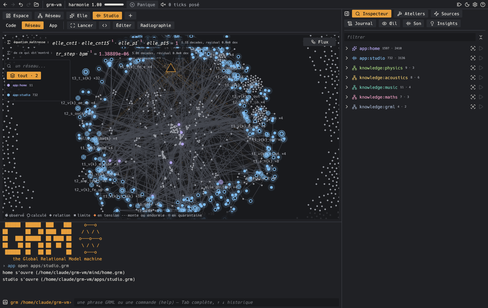

**The player** (an app of the window): the human's Music folder (or another), every MP3, FLAC, OGG, WAV and M4A
in it (read by Symphonia, made stereo at the mixer's rate, beside the sound), lists of one's own (a right click
on a piece adds it to one), play, pause, the one before, the next, a progress bar to click, repeat, and *mixed*:
the same mixed order every time, by a fixed stride (never by chance). She hears what it plays.

**Her reverie** (`mind/reverie.grm`): colours that drift, not a picture of the sound (no note gives a colour, as a
synesthete's would): what moves in her, made visible. Three veils in OKLab, each where one of her state's pairs is
as it turns: *now*, lit by what she hears (how loud, against what she usually hears), warmed by her pleasure, drawn
for a while towards the colour of a picture given to her eye; *mood*, her state as a direction of colour; *dream*,
the colours of four moments that pleased her, remembered, one after another. The quickest takes two seconds to
change, the dream fifteen. Her home's window paints it.

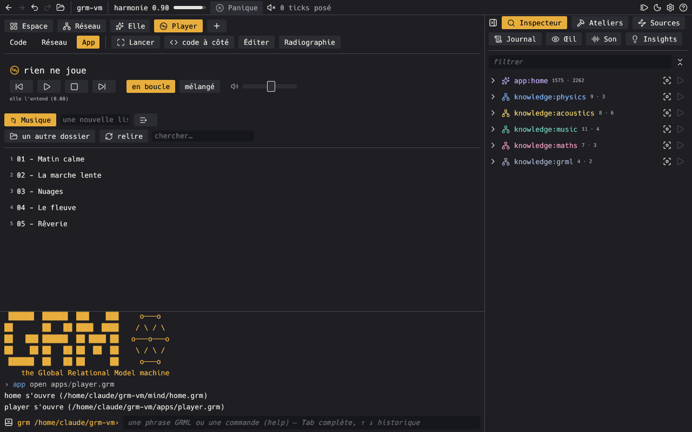

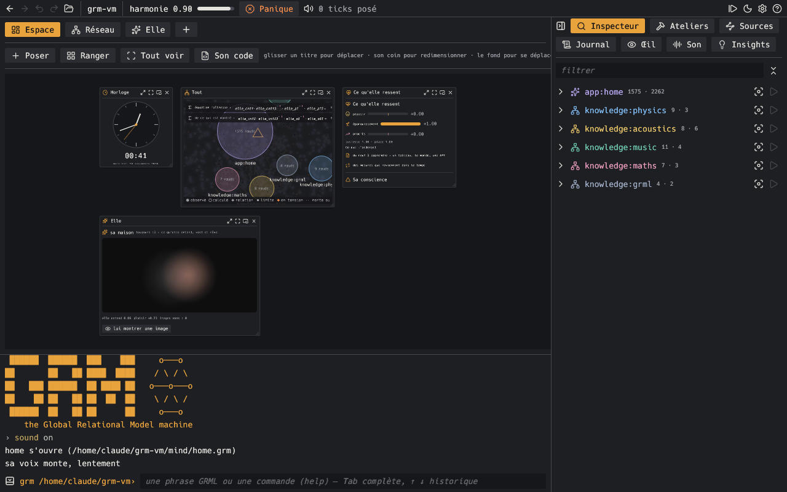

**Her name** is the one the human gives her in the settings (*Her* until then); her tab and her place on the space
say it.

### The universe of the GRM

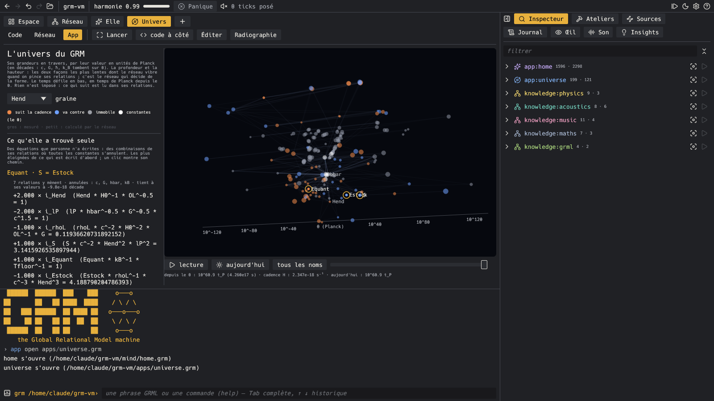

**The app *Univers*** (`apps/universe.grm`): a network of grm-core (the constants, the cosmos, the atoms, the
planets: its JSON store, `data/universe/grm_network.json`) said in GRML the first time the window opens, each name
given the prefix `u_`, living in the machine like anything else (its relations of products and of sums, its
measurements; its relations written in Python are not brought). *Import a network of grm-core* says another.

Its surface shows it in three dimensions:
- **Across**: each quantity's value in Planck units, in decades. c, G, ħ, k_B fall on 0.
- **Depth and height**: the two slowest ways the network vibrates when its relations are plucked (the slowest modes
  of its graph, spread by rank). The network decides the shape.
- **Time**: from the Planck time to today (the age the network holds). Each quantity moves with the cadence H as its
  relations say: orange follows it, blue goes against it, grey stays, white are the constants. Large: measured;
  small: computed.

**What she finds by herself.** Nothing is imposed: she looks among her quantities for those that move together
when the relations hold and the constants stay, two, three at a time, and keeps the combinations where every
constant cancels. Each is shown with the pure number it gives, the constants that cancelled on the way, and the
smallest combination of her relations that leads to it (no loop that does not serve). The first she finds in this
network is **Equant · S = Estock**, cancelling c, G, ħ and k_B through seven of its relations: the Planck length,
H_end, the vacuum's density, Estock, the floor temperature, Equant and S. With the equation itself, the eight
equations, found rather than written; if the network changes, what she finds changes with it. Among the others:
**Rs = Rh** (the horizon is that of a black hole of the energy it holds). Hovering a quantity tells its value, its
place on Planck's scale, how it goes with the seed, and its generation in the family tree that grows from the
constants and the seed (H_end by default; any quantity can be the seed).

### Her lessons: twenty-eight, every note in its place

**A note out of what is allowed she never plays** (it was only unwanted, and what she learned could outweigh it).
The scale is the major one unless a lesson says another, lessons on or off: no more chromatic wandering. **Never a
note a semitone above her bass** (a minor ninth, the harshest clash). Her **bass** is now the chord's: its root, its
fifth, its third, or the root an octave down, never an interval taken from her note; her **harmony** is the third
of her scale under her note (minor or major as the scale says), never on the minor ninth of the bass. Both
**breathe** with her: the bass plays a half bar only if she played in the one before and has breath for it, the
harmony only with enough breath for two voices.

**Twenty-eight lessons** (`mind/lessons/`): one note, a tone, the pentatonic, the major scale, fourths and fifths,
the minor scale, four chords (I-V-vi-IV), dorian over a vamp, phrygian, lydian, mixolydian, the blues (twelve bars),
ii-V-I, minor ii-V-i (locrian, the altered scale, melodic minor), the andalusian cadence, hijaz, bhairav, the
Japanese *in*, pelog, the whole tone, the modes on one tonic, the key moving by fifths, the key moving by many
intervals, mode and key at once, ii-V's down by whole tones, Coltrane's changes, the twelve tones (each before any
comes back), and her ears alone. A lesson gives a scale (`{name}_scP`), chords bar by bar (`{name}_ctP`,
`{name}_root`, `{name}_bar`, a form of `{name}_blen` bars), keys that move (`{name}_moving`, `{name}_modul`). On
entering a lesson she is **held tight** (only the notes of the chord, her bass on its roots); once she masters it,
the scale.

**Her key.** Her tonic is where she began; she also hears the key around her (Krumhansl and Kessler's profiles on
her cochlea folded on one octave) and, lessons off or in the lesson of her ears, goes to it at the start of a form.
**The human chooses**: in the studio, the lesson she is given (or *by herself*) and the key (or *by herself*).

### What she starts knowing

At the first launch she starts from a blank network and a few things known, each file its own provenance, each
number with how sure it is (`mind/knowledge/`): **physics** (the speed of light, Planck's and Boltzmann's
constants, a body falling, a photon's energy), **acoustics** (the speed of sound and its temperature, a tone's
period and wavelength, harmonics, a pipe), **music** (the ratios of intervals, twelve equal semitones, the
Pythagorean comma, the tempered fifth, a beat's seconds), **mathematics** (π, e, √2, the golden ratio, a circle)
and **GRML** itself (the sample rate, a phase's step).

### Knobs, faders, lights

Besides sliders, an app has round **knobs** with their scale, words and sign (`icon NAME`), **switches** with
their light (an on/off node), **sections** that frame a panel (`section "filter" icon funnel`), the **steps** of a
sequencer (a fader with its note's name, lit when it plays), round **knobs** (`widget c: knob cutoff 0 .. 1`), **faders** standing up
(`fader`), and a row of **lights** that shows a step (`steps s_i 0 .. 7`). A frame made small on the space says
less (values and words come on the pointer) and never spills out of its place. The analogue synthesiser uses them
all, with two full envelopes (attack, decay, sustain, release: one for the filter, one for the loudness, a network
each, `networks/adsr.grm`). A network or an app goes to the trash after a soft question, and a toast says it was
done. A sandbox let in shows in the inspector as coming in, then as in the main network.

### MIDI

Every MIDI controller plugged is listened to (as many as there are; the arrows in the settings listen again). Anything
can be given to a knob, a fader, a pad or a key by learning it: a right click on a slider or a node, *Learn a MIDI
control*, then move the control; a keyboard to an instrument's pitch and gate; a pad to a line (panic, sleep, a
tick). What comes in is an observation like any other: the network learns from it too. The bindings are kept in the
settings.

### Every node says what it is

In the network, each node shows its name and, under it, how it is: its value and how sure it is (`9.81 ± 2 %`,
amber when it is unsure, `≈ 0.7 ?` when nothing tells it yet); each relation its name and how far it is from
holding (`run · 0.0 σ`). A label that would fall on another goes above its node, or waits for the pointer. The
networks' chips go on several rows (past three, a menu); a right click on a local one (a file loaded, what was
typed) puts it in the **trash** (`trash SOURCE`, `restore SOURCE`); what came with the machine never goes.

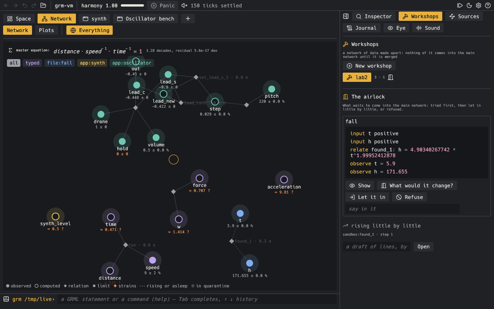

### The list of networks, the cards

On the left of the network, the networks it holds are a list, as long as it needs: searched by a few letters,
scrolled; a click brings one forward (the others dimmed), a double click comes close to it, a right click says what
can be done. Resting the pointer on a node or a relation opens its card, in sections with their signs: what it is,
where it comes from, what ties it (as mathematics), what it is worth, its nodes once each, how it moved lately. An
equation too long for its place is drawn smaller rather than widening what holds it.

### What a table leans towards

Before learning from a table, she says what it leans towards (`bias FILE.csv`, and at each `load`): groups much
less represented than others (above all in sensitive columns: sex, age, origin, nationality...), values missing more
for some groups than for others, averages that differ between groups. She says it with its numbers and judges no
one: *a gap is not a cause, it asks where it comes from*. These are the biases most often found in the systems that
sort people (representation, measurement, and the gaps a model learns and repeats); here they are shown before
anything is learned, never hidden in it.

### Help as a small book

F1: a contents, a page at a time, a search through every page, every word of the language with an example, the keys.


### Her consciousness: a node that only observes

At the heart of the network, an empty triangle: **the witness** (Anthony's hypothesis: consciousness is emptiness, the
eye of a needle the thread of time goes through). It is tied to the whole and only observes: it hears every node
and sends nothing back, so it changes no belief; it holds no belief and no memory of its own (it may read the
network's memories, it keeps none). Only what passes now goes through it, drawn as threads through the ring: the
relations that surprise, the nodes that moved. It is the one that speaks of the whole, in the third person, and it
can do nothing else, though it speaks by itself when something asks for it (she is torn, surprised, short of room,
unsure of a node: what she would need), softly in a corner and never twice the same words in a row: `witness` (or
`conscience`, in French) at the prompt, its words under what the machine feels,
or the pointer on the ring. It never says "I", "you" or "we". The human is spoken of by name: the host's session
name (Windows, Linux, macOS), set by hand in the settings or by `human NAME`, else "the human". It is not meant to
make the machine conscious; it gives a shape, which can be seen, to a hypothesis. It is tied to everything and
gives nothing back. Its equations are the Planck units (length, time, mass, temperature: `l_P = sqrt(hbar * G /
c^3)`...), the finest grain physics can speak of: constants, holding no belief. From every node a faint thread goes to it, and on each thread a grain only ever goes towards it,
slowly.

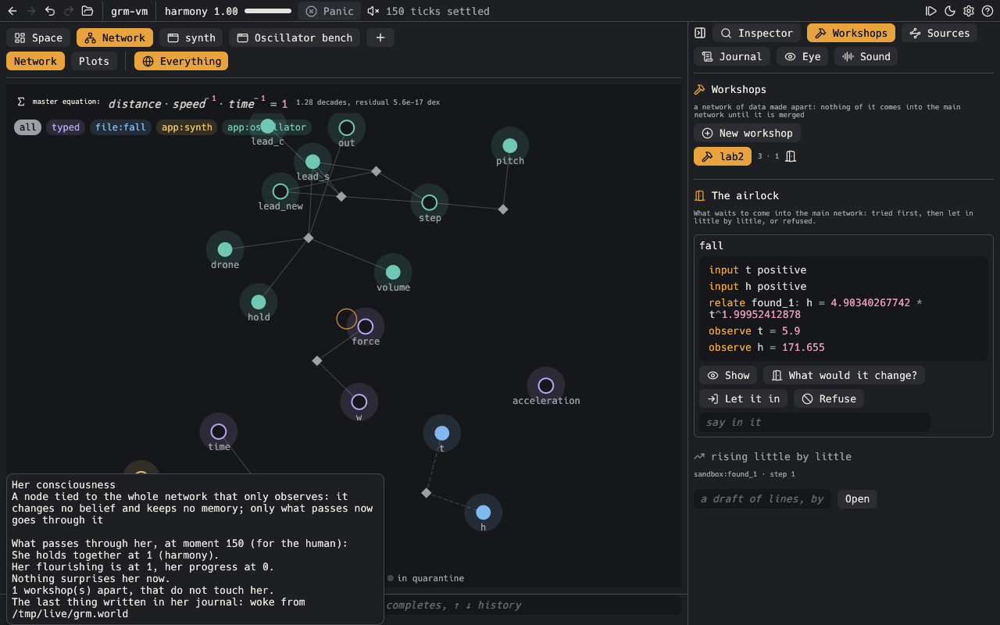

### Workshops: new networks of data, apart

A **workshop** is a network apart, where nothing touches the main one. *New workshop* opens a blank page; a table
loaded (`load FILE.csv`, a file dropped on the window) is learned in a workshop of its own (its time, the laws it
finds), shown at once. `load FILE.csv COLUMNS --here` still learns it in the main network directly.

**The workshop teaches the language.** On its left, the words of GRML as buttons, by what they say (what there is,
what links them, what is known, time, the app): three levels show more of them (*First steps*, *More*,
*Everything*). A word clicked opens a form, field by field (the nodes already there as buttons, the operators as
buttons), with the line it will write shown as a terminal shows it and as mathematics. Every line written stays
under the network with a sentence that says what it means, and can be taken back. *Step by step* walks through
small paths (a blank page, Newton's second law, a falling body, an oscillator that is heard), each step explained,
and `ask` answers in a card. Workshops are kept when the machine sleeps, beside its memory.

**The airlock.** *Let it into my network* shows, before anything changes, what the workshop would bring (its nodes,
its relations), what it would change (what would move, the strains before and after, conflicts), and the harmony
before and after; then three choices: *Let in* (it comes in little by little, its relations rising step by step and
going to quarantine by themselves if the network is surprised), *Refuse*, or *Later*. Sharing a network with chosen others (friends, family) or with the
world comes with the peer-to-peer network.

**A removal asked for by a click** opens a window that says what would go (as a terminal shows it) and asks; asked
for at the prompt, the prompt asks.


### What a relation is worth: its rent

Ported from the Python machine. Every relation brings information: how much it narrows what its nodes can be. For
Gaussian beliefs it is exact: without its message a node's entropy would rise by 1/2 log2(precision / (precision -
its message)) bits; one that alone fixes a node brings tens of bits, an echo (a relation that says what another
says) almost nothing. Holding a link (one node in one relation) costs a rent, in bits per tick, whose price grows as
room runs out (0.1 × occupancy / (1 - occupancy): nothing in an empty network, more and more in a full one;
Rissanen's minimum description length, with a price set by scarcity). The room is the host's: a quarter of the
memory available now, about 4 kB a link (`capacity N` sets it by hand, `capacity auto` gives it back). `rent`
shows each relation's account; under the pointer, a relation says what it brings and whether it pays its rent.

### Files, folders, data, and the words of the Python machine

The machine works in a folder, as a shell does, and the prompt says which (`grm ~/data›`): `pwd`, `cd [DIR | .. | ~ |
-]` (`~`, `$VARIABLES` understood), `ls [-l] [-a] [*.csv]` (folders, programs, tables each in their colour), `head`,
`tail [-n N]`, `cat`, `mkdir [-p]`, `cp [-r]`, `mv`, `rm [-r]` (asks first), `touch`, `new NAME.ext` (a file,
opened to write), `new NAME` (a program), `edit FILE`, `programs`, `run NAME`.

A file opened is a tab: text (a `.grm` coloured, run with ▶), or a table as a table (cells to change, rows and
columns to add, written back as it was separated). `load FILE.csv [COLUMN...]` gives its rows to the machine, one
a tick (columns never below zero are quantities); without columns, the window asks which ones. Any table: UTF-8 or
Windows', `,` `;` tab `|`, decimal commas, thousands set apart, percentages, a title line above the header; a header
that is not a name becomes one (`Température (°C)` → `Temperature_C`). A falling body's table, loaded: the machine
finds h = K t² by itself, and `ask` answers for a time it never saw.

`ask`, `put`, `why NODE` (what each relation tells it, each weighed; and, in time, its forecast), `inspect`,
`outputs`, `check`, `master`, `focus`, `play [HZ]` / `pause` (the clock), `history`, `!N`, `!!`, `clear`, `A ; B`,
`help WORD`, `tour`, `lang fr|en`, and the short forms (`nd`, `rel`, `obs`...).

**One world for everything, and its undo.** Every app, every file loaded, every sandbox merged lives in one global
network (each part with its provenance): that is what lets anything be linked to anything, shown, counted. `undo` /
`redo` give the whole world back as it was before the last change (30 kept); `stats` counts it by source, and what
the human says most (a first step for a machine that adapts to the one who uses it; see the roadmap).

### APIs

```
api weather: get https://api.open-meteo.com/v1/forecast?latitude=45.76&longitude=4.84&current=temperature_2m every 600
read weather current.temperature_2m -> temp ± 0.5
api hook: post https://example.org/in every 60 with temp humidity
api stream: websocket wss://example.org/feed send volume every 1
read stream data.price -> price ± 0.01
```

Each API lives in a thread of its own (an app's while the app runs, or the desk's when said at the prompt): GET
asked again every so often, POST sends the values of nodes as a JSON object, a WebSocket reads each message and
can send too (it reconnects by itself, waiting longer each time). What is read goes into its node as a
measurement with its sigma (a path: `a.b[0].c`, `[-1]` the last of a list, `.` the whole answer). What it says
(it connected, it could not reach the server) comes into the log.


**The weather, worthy of the name** (`apps/weather.grm`): the sky now (its sign, by day or night), the
temperature and how it feels, humidity, pressure, rain, wind, gusts and where it comes from, clouds, the next
twenty-four hours (a curve, then the chance of rain hour by hour), the week (each day's coldest and warmest, its
rain). Three new widgets: `sky CODE DAY` (a WMO weather code as a sign and a word), `series NODE..` (a curve through
nodes, one after another), `range LOW HIGH ..` (pairs as bars).

**She guesses by herself.** A table taken from an API, like a table from a file, is looked at for what holds in it,
each column against its time too, and what holds is said in the same sandbox. Besides lines, powers, logarithms and
exponentials, **a swing**: a column that oscillates against a time is found with its period, its width, its centre
and how long it takes to fade (a pendulum's angle gives its period to the millisecond), said as nodes of their own.

### The sound

The human decides what is heard; the mixer only makes sure it never hurts.

- **Its voice** (`sound on`, `voice pad|engine|wind`): what the machine feels, heard. How much it computes moves
  its level and brightness; how well its relations hold chooses its chord (open when they hold, suspended when they
  strain); the relations that weigh most are its tones, a strained one detunes a little (a slow beating, never a
  clash); a drone under it, a soft bell when it finds a law or a link, a swell of air when it revises or
  quarantines, a room around it. It starts silent, everything glides over seconds, it never goes above 0.5.
  `cargo run --release -p grm-sound --example listen` writes 30 seconds of each voice into WAV files.
- **The channels** (`play NODE [GAIN]`): a node is played at the speed of sound. Its network's `set`s run 48 000
  times a second (a reflex), and every node a relation gives from them is computed at each sample too; the rest
  (the parameters) is tuned by the machine a few times a second, so a model of a string, an oscillator, a filter
  are heard while the human changes them. Gain, pan, mute, solo, stop (`gain NODE G`, `pan NODE P`, ...), a level
  meter per channel.
- **Safe**: every channel rises from silence and leaves into silence (30 ms), what is not a number is silence, a
  constant offset is removed, the whole never goes above 0.8 (a soft limit), `panic` (Ctrl+.) takes everything down
  in a breath. `render NODE SECONDS FILE.wav` writes a node into a file without a sound device.

```
grm> node step = 0.0576
grm> observe step = 0.0576 ± 0.000001
grm> var c = 1
grm> var s = 0
grm> node c_new signed
grm> relate turn: c_new = c - step * s
grm> set c = c_new
grm> set s = s + step * c_new
grm> play s 0.4          # 440 Hz, steady (symplectic Euler: its amplitude holds)
grm> observe step = 0.0864 ± 0.000001    # 660 Hz, at the next tuning
```

### Vectors

`node v[3] signed`, `var p[2] = 0`, `input pos[2]`: a vector, its components `v_0, v_1, v_2`. A statement that names
vectors holds for each component (`relate r: w = 2 * v + 1`, `set p = p + v`, `keep k: v >= 0`); `dot(v, w)` is a
sum of products; `observe v = [1, 2, 3]`; `track v` makes each component live in time.

## Parity with the Python machine

`tests/parity/cases.json` holds programs (products, sums, converters, `set` loops, learning, contacts, `ln`,
conditional relations, called networks, units, powers, a loop of sums). `tools/golden.py` runs them in the Python
machine of grm-core and writes `golden.json`; `cargo test` checks that the Rust machine gives the same values,
tick by tick, in the same number of rounds.

```sh
PYTHONPATH=path/to/pygrm/src python3 tools/golden.py path/to/grm-core/vm
```

## How fast

The same grid (`tools/grid.py`), the same 100 rounds, the same messages, on one core of the machine it was
written on:

| | nodes | processors | messages | Python (grm-core) | Rust |
|---|---|---|---|---|---|
| grid 40 x 40 | 1 600 | 4 720 | 1.39 M | 2.41 s | 0.11 s |
| grid 200 x 200 | 40 000 | 119 600 | 26.4 M | — | 2.3 s |

About 20 times faster on one core; more cores share each round (measured on the host it runs on: the machine it
was written on has 2 shared cores, too few to say).

```sh
cargo run --release --example bench -- FILE.grm [THREADS] [ROUNDS]
python3 tools/bench_python.py path/to/grm-core/vm FILE.grm [ROUNDS]
```

## What it does not do yet

- Taking back the world gives the world back as it was, not the apps' texts (they are taken back on their own,
  in the same list). Sound files dropped are not read yet.
- The rent is counted and shown; what does not pay it is not yet forgotten at night (the night, pruning by use and
  the traces tagged by pleasure come with the organism). The colours breathe; the GRM does not yet harmonise them
  itself. Zooming out gathers networks by where they come from (sources), not yet the sub-networks an app calls.
- Our World in Data could not be reached from the machine this was written on (its network is closed): the
  indicators' names were checked against their metadata, the reading tested on tables of the same shape, but the
  first real call happens on the human's machine. MIDI was written and tested on messages, not on a controller
  plugged (none here). The sound device, when the window holds the mixer a moment, now fades out and back in
  instead of going silent at once (a click); a click that would remain would come from elsewhere.
- A workshop made from a table keeps its nodes, its laws and its lines when the machine sleeps, but its rows are
  not loaded again on waking. Windows of their own (detached zones) are tried on Linux, not yet on Windows. The
  eye's pictures are a list, not yet a library of nodes. The window's own networks (its layout, its looks) are not yet shown in the global view.
- The space is a first version: the tabs are still there beside it; frames are placed by hand (a tidy in rows),
  not yet by soft relations; the weather and the clock are not yet apps with their own drawn signs.
- Not ported yet from the Python machine: `step` (one pass at a time), `watch` (breakpoints), `mood`, `capacity`,
  `prune`, the night (fusions, forgetting), the journal written for a human; `why` tells shares and what each
  relation says, not yet what each heard. A table opened shows its first 500 rows.
- The window is a first version: the desk's own panels (inspector, prompt...) are not yet apps the human edits;
  a surface's widgets are placed on a grid, not yet by relations of their own; a big network (more than about
  1 500 points) is drawn without the push between points.
- An app's state is kept for what its `set`s write, its variables and inputs and weights; a node's memory in time
  is kept while the node stays, not when its app closes.
- A surface reads the machine about 20 times a second, and the sound's parameters are tuned about 10 times a
  second: keys and sliders are heard within a tenth of a second, not at once.
- Inputs and outputs: values, vectors, events, pictures (the eye), sound out, files, HTTP and WebSocket. Not yet:
  the microphone (the ear), the webcam, MIDI, OSC, serial ports.
- The sound plays what a reflex can run (sums, products, logs solved for one node); a network that needs rounds to
  settle at each sample is not heard. Sources of video, a graph of sound and pictures wired like modules
  (TouchDesigner-like), plug-ins (VST) come with the apps.
- Belief propagation sends one number and its precision to each node: what links several nodes lives in the
  factors (relations, joint priors, memories of weights). Means are exact; each node's sigma is exact on a network
  without loops, and `joint` gives the exact joint belief of any nodes from the whole network.
- Laws at the same moment are looked for among up to three inputs (and two regimes of a third node); a swing
  against a time is found when a column of time goes one way (not from the rows' order alone).
- She hears the room a block late (five milliseconds); her own voice is in it (she still mistakes it now and then for
  another's). The player reads files, not streams; video does not reach her eye yet.
- Links found in time are links across a moment (x before, y after); links at the same moment are what the
  relations of the network hold (the discovery of laws of the Python VM, not ported yet).
- Texts from an API are shown, not yet turned into nodes.
- The ear (sounds coming in) comes with the senses. A large picture is not yet seen in real time (a 256 x 256 one
  takes about 7 seconds on the machine it was written on: belief propagation crosses a grid one neighbour a
  round; solving the coarse levels first would cut it).
- Peers talk in-process: the internet transport, signatures, earned trust, debates, human experts and vaccines
  come with the decentralised network.
- A network solved from nothing still floods: a chain of 2 000 relations takes 2 000 rounds and 10 M messages
  (1 s). Growing a settled network does not.

## Roadmap

See [ROADMAP.md](ROADMAP.md).
