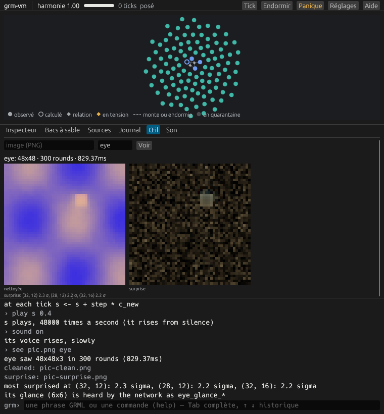
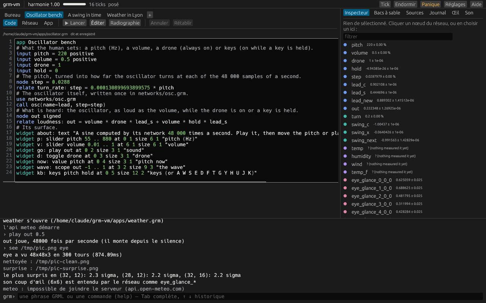
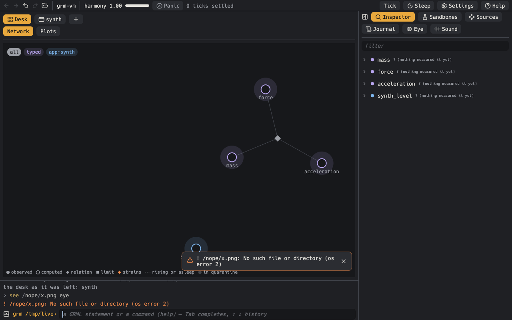
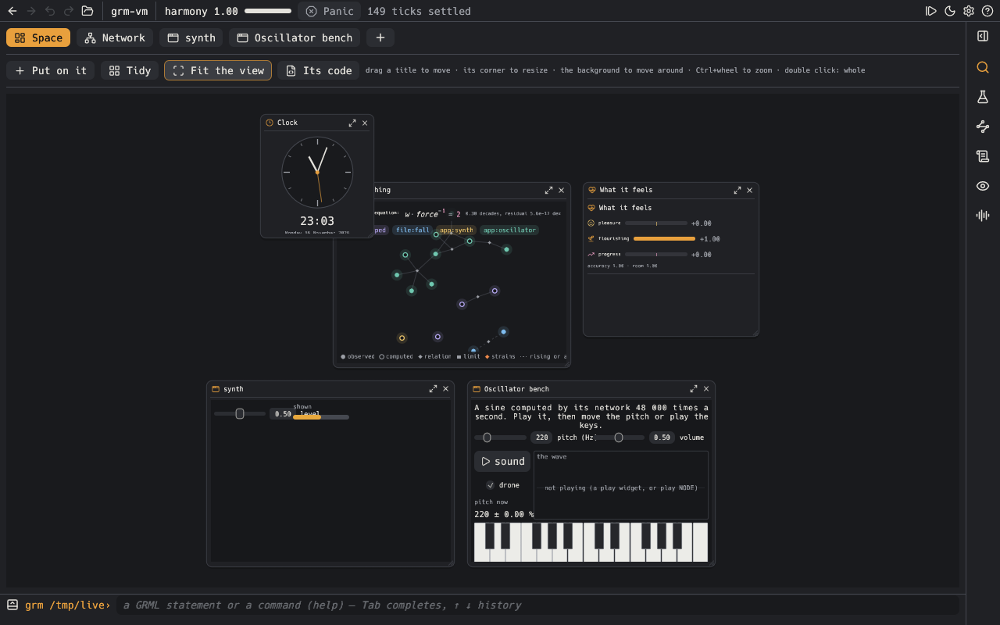
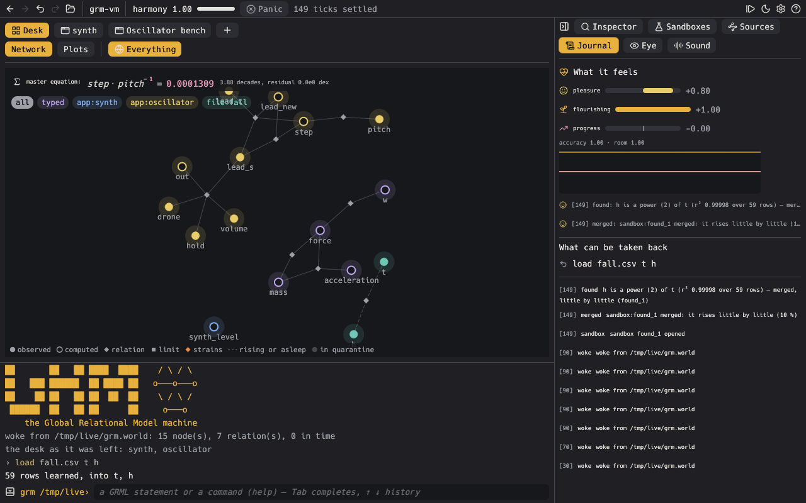
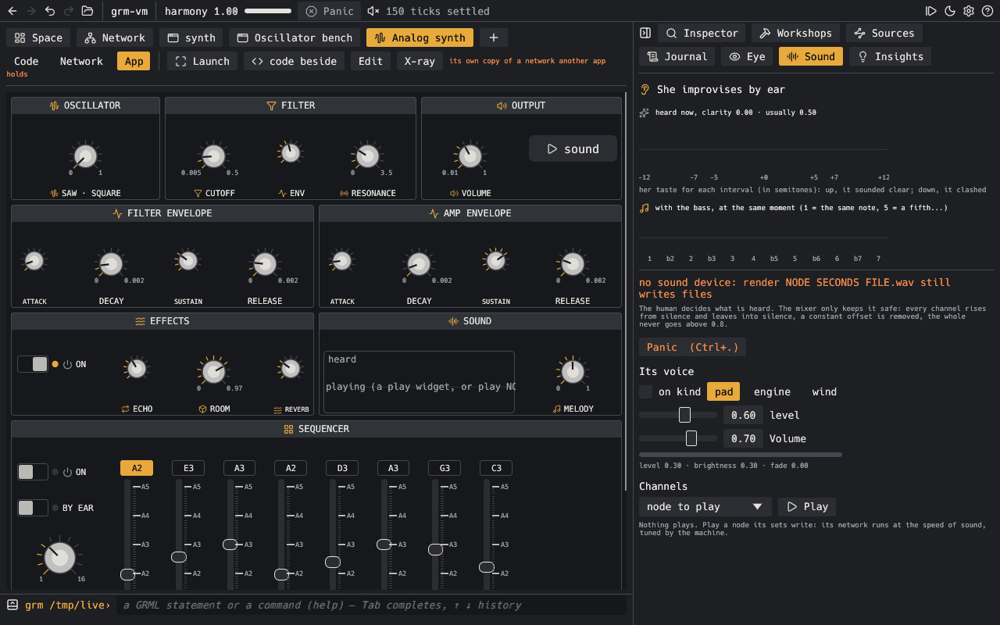
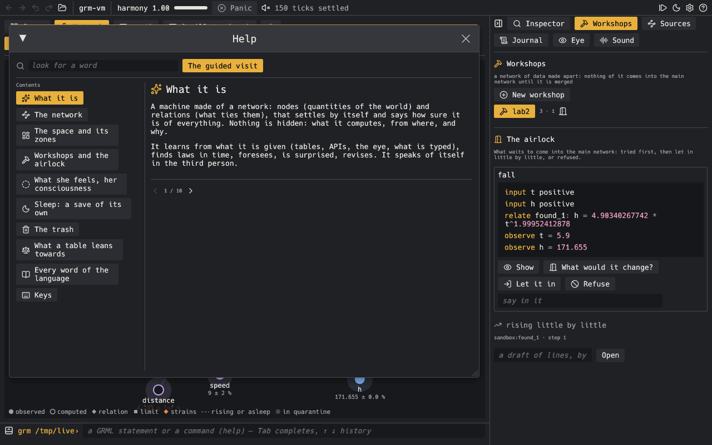
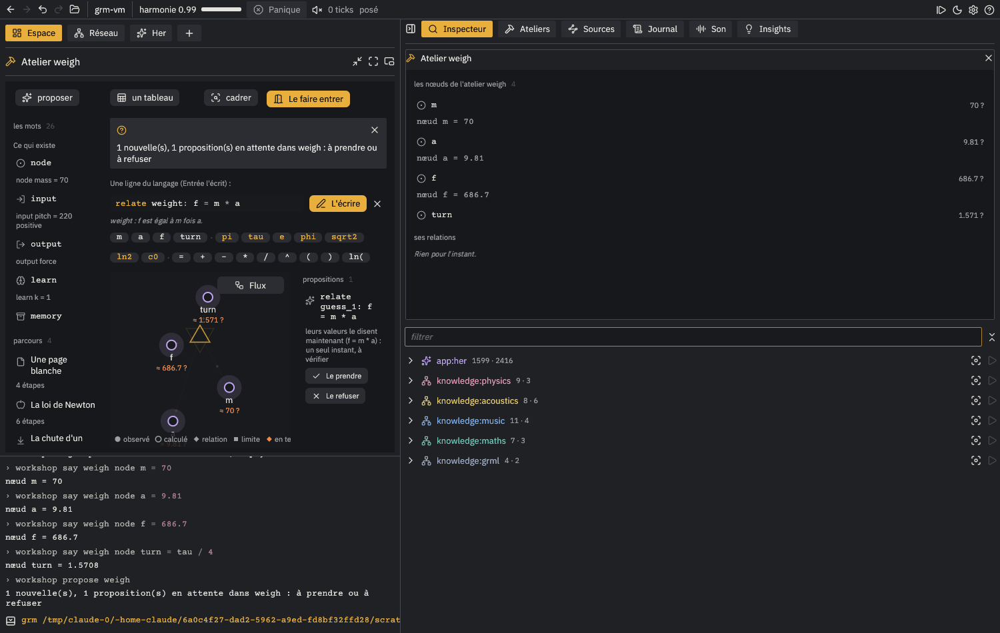

<pre align="center">
 ██████  ██████  ███    ███     o───o
██       ██   ██ ████  ████    / \ / \
██   ███ ██████  ██ ████ ██   o───o───o
██    ██ ██   ██ ██  ██  ██    \ / \ /
 ██████  ██   ██ ██      ██     o───o
</pre>


## What this is, in a few words

**grm-vm is a machine that holds what is known as a network of numbers and of the relations between them, and
that says, for everything it holds, how sure it is.**

You tell it things: *a mass is 2 kg*, *a force is a mass times an acceleration*, *here is a table of measurements*.
It puts each one in the network as a node (a quantity) or a relation (an equation, a law, a constraint), and the
network settles by itself: every value is computed from all the others at once, each with its uncertainty
(`9.81 ± 0.02`), and where things disagree it shows the strain instead of hiding it. Give it data and it looks for
the laws in it by itself (in a table of a falling body it finds `h = 4.9 · t²`), forecasts with how sure it is,
and tells why it believes what it believes: which relation said what, and how much each one weighed.

Nothing is hidden: it is AI in an open box. Every number can be clicked, every relation read as an equation (and
copied as LaTeX), every change taken back, every source put in quarantine.

On top of it, you build **apps**: small programs written in its language (GRML), each one at once a network, a
surface (sliders, keys, plots, scopes) and code, all three changed while it runs. It also makes sound: any node
can be played, computed 48 000 times a second.

### Why

- **One model for everything**: physics, data, music, the layout of its own window. They all live in one global
  network, so anything can be linked to anything.
- **Honest numbers**: an answer always comes with how sure it is, and with where it comes from.
- **Safe by construction**: what is new is tried apart first (sandboxes, workshops), merged little by little, and
  put in quarantine when it breaks the harmony of what is known.
- **Calm**: nothing flashes, nothing jumps; accessibility (screen readers, sizes, contrast) from the start.

### How it works, in one paragraph

Each node holds a belief (a value and a precision); each relation is a factor that sends its neighbours what it
thinks they should be (Gaussian belief propagation). Products and powers are straight lines in logarithms, so most
laws of physics are linear there and solved exactly. A node or a relation only works when a neighbour has
something new to say: a network at rest costs nothing. The machine comes from a Python proof of concept,
[grm-core](https://github.com/innermost47/grm-core), and gives the same numbers.

### What is in this repository

The engine (Rust), a prompt (`grm`), a window (`grm-app`, built with egui), the sound (cpal), connections (files,
tables, HTTP, WebSocket), and a few apps. It is a first version, moving fast: what it does not do yet is listed at
the end, honestly.

Licence: AGPL-3.0-or-later. © 2026 Anthony Charretier. The icons are [Lucide](https://lucide.dev)'s (ISC licence,
`assets/icons/LICENSE-lucide`).

## Build and run

```sh
cargo build --release
./target/release/grm               # a prompt
./target/release/grm program.grm   # says the file, then gives the prompt
./target/release/grm-app           # the window (same commands, same memory)
cargo test                         # everything, the parity with the Python machine included
```

On Linux, the sound needs ALSA's development files to build (`libasound2-dev` on Debian and Ubuntu); the window
needs nothing more than a graphics driver (OpenGL).

At the prompt: the language (GRML, as in grm-core: `node`, `relate`, `keep`, `observe`, `forget`, `var`, `set`,
`learn`, `input`, `output`, `fuse`, `network ... end`, `call`, `use`), and `help` for the rest.

```
grm> node x signed
grm> relate r: y = 2 * x
grm> observe x = 1 ± 0.001
grm> sandbox idea
grm> in idea: relate lie: y = 10 * x
grm> trial idea
  merge of idea: 0 new node(s), 1 new relation(s)
  harmony 1.000 -> 0.665
  surprise x: moved 1000.0 sigma
  surprising: it would need to be confirmed (not rejected)
grm> merge idea
grm> tick
grm> status
  ⚠ in quarantine: sandbox:idea
```

## What is in it

| | file | |
|---|---|---|
| the language | `lang.rs` | GRML, statement by statement, as grm-core reads it |
| the network | `network.rs` | nodes, relations, measurements; each with its **provenance** (who said it, from where) and its **strength** |
| the machine | `machine.rs` | belief propagation: rounds, ticks, `set`s, learning |
| the world | `world.rs` | the global network, **sandboxes**, **trial merges**, **integration little by little**, **quarantine**, **recall**, `remove`, the logbook |
| the engine | `engine.rs` | the machine in a thread of its own, computing a frame at a time, publishing snapshots |
| ports | `ports.rs` | what comes in and goes out: values, vectors, events (a click, a key), images and sounds (their adapters come with the senses) |
| clocks | `reflex.rs` | the speed of sound: a network's `set`s run directly, 48 000 times a second, tuned by the machine above |
| peers | `peers.rs` | machines that share what they believe, never their data, without a centre |
| hidden state | `hidden.rs` | what a node really is behind what is measured of it: a Kalman filter that follows it, an expectation-maximisation that consolidates its law, the world's noise told from the senses' |
| time | `time.rs` | nodes that **remember** (precise near the present, coarser further back), **learn how they move** in real time, **find links by themselves**, are **foreseen** with a confidence, and say **why** |
| the world outside | `grm-connect` | web APIs: what an answer can give (fields, kinds, units), the chosen fields into a sandbox, their rows each at its moment; Open-Meteo and Our World in Data to begin with |
| laws | `discover.rs` | what holds between nodes at the same moment (a line, a power, a product of powers), found in the rows it has seen and proposed through a sandbox |
| the eye | `vision.rs` | pictures: a network of its own near what it sees (pixels tied to their neighbours, a pyramid above them), that cleans, fills, keeps edges, is surprised, sees what changed, and sends a glance to the world's network |
| units | `units.rs` | a node with a dimension is given in SI, counted inside in Planck units |
| the prompt | `grm-shell` | every command, the same in the terminal and in the window: a line goes in, lines come out (said, dim, a warning, an error, a question waiting for y/n) |
| the sound | `grm-sound` | the machine's own voice, the mixer of the human's channels, the sound device, WAV files |
| the window | `grm-app` | the network, the prompt, the inspector, sandboxes, sources, journal, eye, sound; apps as code, network and surface; placed by a GRM network |
| apps | `grm-shell` (`apps.rs`, `runtime.rs`) | an app's file read (`use` and `call` unfolded, its surface and APIs set apart), run, edited while it runs, closed, kept with the desk |
| APIs | `grm-connect` (`api.rs`) | GET every so often, POST, WebSocket, each in its thread, what it reads into nodes |

### Never waiting, never computing for nothing

- **A round is shared out between threads** when there is enough to do, and gives the same numbers on 1 thread or
  32: each processor reads only what the round before wrote (tested bit for bit).
- **Only what moves is computed.** A processor that hears nothing new does nothing. A measurement wakes its node
  only. A network that grows (a relation added, a file said) goes on from where it was: only what is new is woken
  (adding one relation at the end of a chain of 300 costs a few messages, not the chain again).
- **Anytime.** The engine computes at most a frame (8 ms by default), then publishes where it has got to: what is
  shown is usable even before it has settled. A capped round (`Budget`) takes the biggest news first.
- **Nobody waits for the engine.** Whoever talks to it sends orders and reads snapshots.

### Trying apart, merging carefully: the beginnings of an immune system

- **A sandbox** is a network of its own. It reads the global network's beliefs at its border as fixed
  measurements, and computes only itself; the global network does not know it is there.
- **A trial merge** puts it into a working copy of the global network (starting from where the global machine is)
  and reports: new nodes and relations, what it would replace, names said differently, the relations that would
  hold less well, the harmony before and after, the nodes it would move further than 3 sigma. Something
  surprising is not rejected: it is said to need confirming.
- **Merging is gradual**: the new relations rise in strength (10 %, 25 %, 50 %, 75 %, 100 %), one step a tick.
- **Quarantine**: if the harmony falls (the relations, and what the world was measured to be) or a surprise
  rises while they rise, they go back to 0. They stay visible until released or recalled.
- **What a source taught can be taken back**: the weights keep what they learned by source; a quarantine or a
  recall takes it back.
- **Recall**: everything that came from a source, taken away at once, everywhere (what others still hold stays).

### Machines without a centre

Two machines that share nodes exchange messages about them (a precision and a mean): never their data. What a
machine tells a peer leaves out what it heard from it (nobody counted twice). What a peer says comes in as a node
of its own, tied by a relation of the peer's provenance, its certainty capped by the trust it has: a peer can be
put in quarantine or recalled like any source. The transport here is in-process; the internet's comes later,
with the same messages.

### Time: remembering, learning, foreseeing

- **Memory**: the last moments one by one, then spans twice as long, again and again (a memory that grows with
  the logarithm of time, each span with its mean and its spread; inspired by the scale-invariant memory of time,
  Shankar and Howard 2012). `rewind` reads it back.
- **A law of motion learned in real time**: its next value from its last ones (two lags: it can swing, with its
  period and its damping), from the nodes it is coupled to, and a constant; a Bayesian regression that forgets
  slowly, so it follows a world that changes.
- **Links found by itself**: shadow laws try the couplings a node does not have; one that predicts what comes
  clearly better (e^6 of evidence, measured before seeing each moment) becomes part of its law, and the logbook
  says so. A link that predicts is not yet a cause.
- **A hidden state**: once it has seen 64 moments, a node learns what it really is behind what is measured of
  it: the world moves (`x_t = a . x_past + b . u + c + w`), and is measured with an error (`y_t = x_t + v`). A
  Kalman filter follows it moment after moment (a missing measurement: it goes on, less sure); every 24 moments
  it consolidates its law, the world's noise and its senses' noise on the 480 moments it keeps one by one
  (expectation-maximisation with a Kalman smoother, Shumway and Stoffer 1982). A law that would blow up is
  brought back inside. On a swing read by a poor thermometer, its 24-moment forecasts are three times narrower
  than a law learned straight on the measurements, and still hold the truth.
- **Cycles found by themselves**: shadow laws also try the rhythms its past seems to hold (the strongest peak of
  its periodogram, and a day and a week when it counts in hours). A cycle is a rhythm it is measured with, on top
  of its state (an amplitude and a phase), learned with the rest.
- **Critical thinking**: a link or a cycle found quickly on the measurements is looked at again with the hidden
  state: it must explain what the node remembers clearly better than without it (by half the log of the moments
  per weight it adds, as the Bayesian information criterion asks); at once when it is found, and all its links
  every tenth consolidation. A link that does not pay for itself was an echo of the senses: the node stops
  believing in it, does not try it (or a rhythm close to it) again, and the logbook says so. On the weather, the
  temperature keeps its day; the humidity's day is dropped (it comes through the temperature it follows).
- **Searching afresh**: every tenth consolidation starts again from several points, not only from what it
  believed: a belief can be a dead end.
- **Thinking in parallel**: consolidating and thinking again are the long part; each node does it on its own,
  all at once, on as many cores as there are (the numbers do not depend on them).
- **Foresight**: the tracked nodes run forward together, 300 times, each run drawing a law it could have, where
  it is now, the world's noise and its senses' noise: the spread widens with the horizon.
- **Why**: a confidence (1 minus its uncertainty against how much it usually varies), where its uncertainty comes
  from (the world moving, its senses, its ignorance of its own law, not knowing exactly where it is now), the
  noises it has told apart, what each part of its law contributes, every node and source it
  rests on, and how many of its past forecasts fell within one sigma (does it know how much it knows?).

```
grm> connect meteo 48.86 2.35 30        # (or: connect file answer.json, connect owid co2 France)
grm> take meteo 4 5                     # the fields chosen become sandbox meteo
grm> trial meteo
grm> merge meteo
grm> feed meteo                         # 720 rows, each at its hour; found by itself: humidity follows temperature
grm> forecast temperature_2m 24
grm> why relative_humidity_2m 3
grm> rewind temperature_2m -240         # ten days ago, as remembered
```

### Memory between sessions

The whole world falls asleep in a file and wakes exactly as it was: its network, the state of every processor,
its sandboxes, what is rising and what is in quarantine, its logbook, its rows, its laws, and its nodes that
live in time (their memories, their laws, their hidden states). The prompt wakes from `grm.world` (or
`$GRM_MEMORY`) when it starts and falls asleep there when it quits; `sleep FILE`, `wake FILE`, `forget everything`.
A world put to sleep and woken goes on with the same numbers, to the last bit (tested).

The desk sleeps beside it: the apps that run and their own copies (`grm.desk.json`), the APIs said at the prompt,
what played and how, the machine's voice; and the window as it was left (`grm.window.json`): which app is shown
and how (code, network, app, launched, edited, x-rayed), the side panel's tab, the selection, where every point of
the network was put and how the view was moved, the panels' wishes, the log and the prompt's history. The world
is also put to sleep every minute while the window is open, and when it closes (Ctrl+Q).

### Laws at the same moment

The rows it measures are kept evenly along what it lived (400 at most: when there are too many, one in two is
let go). After a file, and on `discover`, it looks for what holds between its columns on every row (r² ≥ 0.999),
the simplest form first: `y = a x + b`; else the best of `y = k x^p`, `y = a ln(x) + b` (the Hubble law, in
magnitudes) and `y = k e^(a x)` (a decay); for what no single node explains, sums `y = a1 x1 + a2 x2 [+ a3 x3] + b`
and products of powers `y = k x1^p1 x2^p2 [x3^p3]` of two, then three nodes (the fewest that hold, each of them
counting); and two straight lines in two regimes of a third node (`when z in lo .. hi`, the value
where it changes searched among all). A law that needs a logarithm says the nodes that hold it. Coefficients are
written to twelve digits, and a law is never held surer than that (a law rounded and held exactly would
contradict the same law said the other way). Each law is written in its language (with its spread as its
sigma) and proposed through a sandbox: a compatible one is merged little by little; a surprising one waits in its
sandbox for a human.

### A value missing

A value missing from a row is no measurement. A node that lives in time is then given what it expected (its
forecast and its spread) as a soft measurement, so its relations still hear of it; it is never remembered as
measured.

### The machine following a node itself

`embody NODE`: the machine holds a node's hidden law as its own relations: its state, its states before (carried
from tick to tick together, with their uncertainty and how they move together: `carry x = y` and
`carry a, b = c, d`, new statements of the language), its law (the world's
noise as its sigma), and how it is measured (its rhythms, its senses' noise). The machine then follows the node
as a Kalman filter does, with every other relation of the network heard at once, and foresees the moments not
measured. On a world read by a thermometer erring by ± 0.5, what the machine believes is within ± 0.29 of the
truth. The law is held again each time it is consolidated.

### Believing together

`joint NAME...` (or a vector's name): what the network believes of several nodes together, as one Gaussian of
several dimensions: each value with its exact sigma, and how they move together. It is computed from the whole
network at once (its information matrix, drawn straight where it stands, solved by conjugate gradients): two
unknowns whose sum is known move against each other (-0.99), as they should.

### Beliefs held together

`carry a, b = c, d`: at each tick, what the network believes of c and d together (their means and their
covariance, computed from the whole network) becomes one prior over a and b: a state of several parts carried as
one. `observe v = [1, 2] cov [[1, 0.9], [0.9, 1]]`: a vector measured together; measuring one of its components
then moves the others with it. Such beliefs are factors of the machine over several nodes: belief propagation
carries what they say to each node.

### The eye

`see FILE.png [NAME]`: an eye sees a picture (grey or colour). It is a network of its own, as a retina is: every
pixel a node, tied to its neighbours ("I look like the one beside me, more or less"), and a pyramid above them
up to a glance of 8 x 8 nodes. It computes near what it sees and sends on only what is worth it:

- **cleaned**: its noise taken away, its missing pixels filled, its edges kept (a neighbour that differs much is
  believed less and less: robust weights, drawn again three times);
- **surprised**: at each pixel, how far what came is from what the rest of the eye said it would be, in sigmas
  (the message belief propagation already sends the pixel);
- **what changed** since the last picture, in sigmas;
- **a glance**: the top of its pyramid, heard by the world's network as inputs `NAME_glance_x_y`.

Pictures are written beside the one seen (`-clean`, `-surprise`, `-change`). An image port feeds an eye too.

In the window, the Eye tab says what it does in four signs (a picture comes in; it is cleaned; what surprises it
is shown; its glance goes to the network). Several pictures are chosen at once, each seen by an eye named after its
file, with a slow wheel while it works; the path goes once a picture is seen. A picture clicked opens large, and the
arrows go from one to the next through every eye (a carousel); a double click on an eye in the network does the same.


On a 48 x 48 picture with noise of ± 0.10 and 15 % of its pixels missing, what the eye sees is within ± 0.028 of
the truth, the missing pixels within ± 0.04, and the edges stay sharp; a 64 x 64 picture takes half a second on
the machine it was written on, a 256 x 256 one about 7 seconds. Recognising what is in a picture is another step (features learned), not this one.

### The window

`grm-app` shows the machine as it is, and every button is a line said to the prompt (it shows in the log: nothing
happens behind the human's back).


- **The network**: nodes (circles: filled when observed, hollow when the network computes them) and relations
  (diamonds; squares for limits), linked as the machine holds them. A colour per source (kept when others come or
  go); amber for a relation that strains (never red); faded for what is in quarantine; dashed for what rises little
  by little or sleeps. An eye's glance is one point. Click to inspect, Ctrl+click to add, Shift+drag a box, drag a
  node to put it somewhere, wheel to zoom, drag the background to move, right click for what can be done. It moves
  slowly, and stops when it is at rest.
- **The prompt**: history (↑ ↓), completion (Tab: commands, nodes, sources), Yes / No when it asks. In French,
  the machine's usual answers are said in French in the window (the others stay in English).
- **The inspector**: value ± sigma (a positive node's spread as a percentage), where it comes from, what it is
  (observed, computed, fixed, written by its sets, learned, an input, an output, in time), its relations with their
  strain; for a node in time, its memory and what it will be (a line, its spread, the forecast dashed with its sigma
  and the range of its draws), and why. Several nodes: what the network believes of them together.
- **Sandboxes** (say in it, run, trial, merge, refuse), **sources** (quarantine, release, recall), the **journal**,
  the **eye** (what it saw: cleaned, surprised, what changed), the **sound** (its voice, the channels).
- **Accessible and calm**: everything by the keyboard (Ctrl+L the prompt, Esc, F1 help, Ctrl+1 … 6 the tabs, Ctrl+.
  panic), screen readers through AccessKit, text size, dark or light theme, French or English; nothing flashes,
  what changes glides, and the window repaints only while something moves. (The machine itself still answers in
  English: its messages come from the engine.)
- **Placed by relations**: the panels are nodes of a small GRM network of their own. The window's size comes in as
  two inputs; soft wishes (`side = 0.3 * W ± 0.03`) and limits (`keep side >= 300`) decide; dragging an edge adds a
  wish, stronger than the share, still within the limits; a narrow window switches regime (`when W in 0 .. 860`)
  and the side panel goes under the network. The settings show its statements and its harmony.



`grm-app --fresh --script LINES.txt --select a,b --tab sound --size 1280x800 --theme light --lang fr --screenshot
OUT.png` says the lines, takes a picture of the window and closes (to test it without anyone in front of it).
The drawing is behind the model (`model.rs`, `graph.rs`, `layout.rs` know nothing of egui): the renderer can
change without touching them.

### Apps: what the human builds on it

An app is one file of the language: its network, its surface, its APIs, the commands it runs when it opens.

```
app Oscillator bench
input pitch = 220 positive
input volume = 0.5 positive
input hold = 0
node step = 0.0288
relate turn_rate: step = 0.000130899693899575 * pitch
use networks/osc.grm                      # networks written once, used by many apps
call osc(name=lead, step=step)
node out signed
relate loudness: out = volume * lead_s + volume * hold * lead_s
widget p: slider pitch 55 .. 880 at 0 1 size 6 1 "pitch (Hz)"
widget go: play out at 0 2 size 3 1 "sound"
widget wave: scope out -1 .. 1 at 3 2 size 9 3 "the wave"
widget kb: keys pitch hold at 0 5 size 12 2
```

- **Three views of one thing**: its code (coloured, its line numbers, the lines it could not say in amber with
  why), its network (only what it holds and the nodes it touches), its surface. A change in one is at once in the
  others: there is no build. Each change is said again into the running app in one step (nothing in between is
  ever seen), it goes on from where it was (what its `set`s write, its variables, its inputs keep their values),
  what it plays goes on without a click, and the file is written at once. Undo, redo.
- **The surface**: widgets on a grid of 12 columns (the width is shared, whatever the window): `slider`, `toggle`,
  `button` (1 while held), `meter`, `value` (± sigma), `plot` (through time, with its spread), `text`, `picture`
  (what an eye saw), `pad` (two nodes at once), `keys` (a keyboard of notes: the frequency, and 1 while held; the
  computer's keys A W S E D F T G Y H U J K play it too), `play` (plays a node, stops it), `scope` (what a node
  that plays sounds like). A widget that touches measures its node; a widget that shows reads its value and spread.
- **Edit mode** (Ctrl+E, a button, also when launched): the app keeps running and sounding while its widgets are
  moved and sized (snapped to the grid; a widget never goes over another), chosen to change their line, added
  (kind, nodes, name), taken away. Made to be used live, on stage.
- **X-ray** (Ctrl+R): over each widget, its line in the file, the node it is bound to, its value ± sigma and where
  it comes from. Nothing of what an app does is hidden from who uses it.
- **Its network, by hand**: drag with the right button (or Alt) from a node to another: a relation, written first
  in a small window, then added to the app's file. A relation an app writes can be edited from the inspector
  (its line). `remove` of something an app writes asks, and takes the line from the app's file.
- **Launch** (F5): the app alone in the window. Esc: back.
- **Several networks, shared**: `network NAME(p, q) ... end` in a file, `use FILE`, `call NAME(p=..)`: unfolded
  into plain statements, so every name the machine holds is written somewhere. Two apps can use the same network:
  while only one runs, it holds it; when a second one opens while the first runs, the second runs its own copy
  (its names given its prefix, `synth__lead_s`), said in the log and in its bar.
- **Nothing forgotten by the machine**: what an app holds is never taken away by the machine itself; `remove`,
  `recall` and `quarantine` of it ask first. Closing an app (`app close NAME`, or its tab's menu) keeps its file
  and what it was living through, for when it opens again.
- **`clock S`**: the world ticks every S seconds while the app runs (the shortest asked wins).
- Apps are the `.grm` files of `apps/` beside the world's memory (or `$GRM_APPS`); `+` in the tabs opens one or
  makes a new one; `apps`, `app open|new|close|undo|redo NAME` at the prompt. Three come with it: an oscillator
  bench (sliders, keys, a scope, sound), the weather of Lyon (an API every ten minutes, a relation to Fahrenheit,
  a plot), a swing in time (a clock, a node tracked: its memory, its forecast, why).





### Seeing it work

- **The master equation**, top left of the network: what the relations of products say together once every node
  in between is eliminated (in log, a chain of straight lines; what is left links the nodes at its ends), with how
  many decades its nodes span and how far it is from holding. Under it, the one of what is shown (an app, a network
  brought to the front). Nobody wrote it: the network holds it. `master [SOURCE]` at the prompt.
- **Under the pointer**, a node or a relation says everything: its value ± sigma, where it comes from, what it is,
  its relations or its equation, and its curve as it moves now (a node that plays: its wave, as it sounds).
- **Right click**: what can be done, each with its sign and a line saying what it does (inspect, follow in time,
  forecast, play, plot, relate to…, edit its line, quarantine its source, remove; on the background: a new node by a
  small form — its name, its kind, its value — written in the code of the app shown, a new relation, fit, plots).
- **The networks in the network**: a chip each above the view (`typed`, an app, a file, a sandbox), a soft halo
  of its colour around its nodes; a chip brings it to the front (`focus NAME`).
- **Plots** (desk or app): the nodes through time (one track each, never two scales on one axis), one against
  another, a path (a phase), their values now with their spread.
- **A sandbox shown** in the middle, as a network of its own (Sandboxes → Show), with run, trial, merge, refuse.
- **The code beside** (`</> code beside`, Ctrl+K): an app's code docked right, left, top or bottom while its network
  or its surface is shown; a line typed appears in the network, a node made by the mouse appears in the code.
- **The guided visit** (`tour`, or the help): one part of the window lit at a time, the rest dimmed; it comes by
  itself the first time.


### The machine's look

A palette (night, day, ocean, contrast, or each colour by hand in the settings: background, panels, buttons, text,
quiet text, accent, strain), a typewriter font everywhere if wished (on by default), the machine's name in block
letters when it wakes, a taskbar icon. Apps inherit it.

**Looks: style as a network, not as classes.** An app says `look NAME: accent = #7fb8f0, background = .., text =
.., round = 10, size = 1.3 [when NODE in LO .. HI]` and a widget wears it (`widget go: play out look big`). Each
property is a node of a small GRM network of its own: the machine's palette is measured into `vm_*`; the app's look
(`app_*`) is held to it, and each named look to the app's, by soft relations, each parent held a hundred times more
surely than its child (so the cascade goes one way); what a look says holds at ± 0.0001, so it wins; what it does
not say is inherited. A look with `when` holds only while its condition does; the hour comes in as an input, and
with "follow the hour" the evening warms the accent and dims the background (relations, not code). `style
STATEMENT` says anything of the language into that network (`style relate breathe: big_size = 1 + 0.2 * warmth`).

### Getting around, and taking back

- **Back and forward**, as in a browser (the arrows top left, Alt+Left / Alt+Right, the mouse's side buttons): the
  places the human has been (the desk or an app, in which view; a file; a sandbox; what was selected; the side tab;
  where the view looked).
- **One undo for everything** (Ctrl+Z, Ctrl+Shift+Z or Ctrl+Y, or the arrows top left): the world (the prompt keeps
  it as it was before each change), an app's text, an app opened or closed, where the nodes were put, the settings,
  a table's cells and its rows and columns. One list, in the order the changes were made, shown in the journal
  (what can be taken back, and what was and can be given again). While words are written in a field, Ctrl+Z is the
  field's own.
- **Files dropped on the window** are opened as what they are: a picture (PNG) is seen by the eye, an app runs,
  a table opens as a table, any other text opens to write; a folder becomes where the machine works. Or **Ctrl+O**
  (the folder sign): the system's own window to choose them (where the desktop has a file portal; otherwise it
  says so).
- **The inspector is an accordion**: every node a line; a click unfolds what it is in place (several can be open);
  a node chosen in the network unfolds there, and the list goes to it.
- **The prompt is coloured** as code is, as it is typed and in what was said.
- **Signs, never emoji**: every sign is a Lucide icon, drawn and tinted with the palette; an app wears one
  (`icon audio-waveform` in its file, any of the 2 359).
- **A new app**: + then *New app*: its name, Enter. Right click on an app's tab: launch it, close it, or put it in
  the **trash** (`app trash NAME`; it comes back with `app restore NAME`, from the Sources tab, or by Ctrl+Z).
- **The side folds** into a rail of signs, and opens again on the tab whose sign is clicked; its width is the
  human's (drag its edge), and it goes down to the bottom of the window. **The prompt folds** to its one line.
  The **panic** button is always at the top, beside the harmony.
- **What goes wrong is said softly** in a corner for a few seconds (it blocks nothing, comes and goes slowly, can
  be closed), and kept in the prompt's lines.
- **Paths with spaces** are said between quotes (dropped or chosen files are quoted by the window); typed without
  quotes, words that together name a file that exists are one (`see C:\Pictures\Capture d'écran 1.png eye`).
- **A big picture** is made smaller before the eye sees it (its longest side at most 160 points: seconds, not
  minutes).
- **Two tables with the same column names**: before their data would be mixed in the same nodes, the window
  proposes other names (`load FILE COLUMN=NODE`, or `--mix` to mix them on purpose).
- The code beside **wraps** its long lines (each number stays on its line's first row); fields have room inside
  and what they wait for is written in italics.



### The space: a table, not a desk

The first tab is a **space**: an infinite table (drag the background to move around, Ctrl and the wheel or two
fingers to zoom) where the human puts what they want, in their own order or their own mess, and a button tidies
it. On it: **apps** (an app and a widget are the same thing: small on the table it is a widget, bigger a window,
double clicked it opens whole), **networks** (each looked at its own way), files, plots, what the machine feels, a
clock. Several apps live side by side and play at once. A frame moves by its title and grows by its corner.

**The space is itself a file**, `space.grm` beside the memory, one line per thing on the table
(`place app weather at 40 60 size 420 300`): *Its code* opens it, and what is written there is what is shown.

**Every zone is four things**: small on the space, in place of the space, the whole screen, or a window of its
own (a real window of the system, to put on another screen). Its signs are on its title; a double click inside a
frame brings it in place of the space; Escape or closing its window puts it back on the table.

The machine's voice (the wind, the pad) is turned on or off from anywhere: the speaker at the top, or Ctrl+M.



### The inspector as a tree, formulas as mathematics, from the large to the small

- **The inspector is a tree**, browsed as a file explorer: the networks (each with its sign: an app's own, a
  keyboard for what was typed, a table for a file...), then their nodes and their relations in two folders, then
  what each holds (a node's relations, a relation's nodes). Every line can do two things: **show its detail**
  (a click: for a network, its master equation and its curve, what it brings and what its links cost; for a node,
  its value, what it is, its curve, its actions; for a relation, its formula, its strain, its worth) and **unfold
  its children** (the chevron). Every line has its sound (play, which becomes stop while it is heard; a network
  plays its outputs) and, under the right button, what can be done with it. A relation clicked in the network
  opens there too.
- **Formulas are drawn as mathematics** (fractions, powers, functions), in the inspector, under the pointer and in
  the master equation; a right click (or a double click) **copies them as LaTeX**
  (`\mathrm{force} = \mathrm{mass} \cdot \mathrm{acceleration}`).
- **A master equation has its curve**: its first node along, its second as it follows (the others held where they
  are), in log on both sides (a power law is a straight line), and where the network is now.
- **From the infinitely large to the small**: zooming out, the networks gather, each into one node (its size, its
  colour, the relations that join it to others as thick as how many); a double click on one (or on any node, or
  *Go into it* in the tree) goes into it, and only it fills the view. *Everything* (or Alt+Left) comes back out.


### What it feels

Ported from the Python machine's mind, and shown in the journal, as quantities and as curves:
**pleasure and displeasure** (the dopamine neurons signal the difference between what was expected and what came:
the machine expects a certain surprise from its inputs, and being less surprised than it expected is pleasure,
more is displeasure; finding something by itself, or taking in what it tried apart, is a burst of pleasure; what it
has to put in quarantine or refuse, a burst of displeasure; with nothing new, it comes back to rest),
**flourishing** (accuracy, its inputs no longer surprising it, times room, the links it can still hold) and
**progress** (how much its surprise is falling: what it is learning now). What the human does is a signal too
(taking something back is a little displeasure, giving it again a little pleasure), and every moment that moved it
is written with why. Nothing of it leaves the machine.

**Living colours** (on by default, a switch in the settings): a slow breath through the palette (a few degrees of
hue, a hundredth of light, over half a minute and more; never a flash), the sound lifting the accent a little.



### The world, from Our World in Data

*Let the world come* (in the Workshops tab), or `world PLACE` (`monde`): twelve public indicators of Our World in
Data, in six categories (health, people, economy, energy, climate, knowledge), for a place (`World` by default, or
a country by its English name: `France`, `Germany`...). Each category is learned in a workshop of its own
(`world_health`, `world_climate`...), year by year, its source said beside each node; what ties the categories is
for her to find (and to let into the main network through the airlock). The tables are kept a week beside the
memory, and read from there offline.

### An analogue synthesiser, every module a network

The *Analog synth* app is written in GRML from end to end, nothing ready-made: a saw and a square
(`networks/saw.grm`, `square.grm`), a filter of four poles with its resonance (`ladder.grm`), an envelope
(`envelope.grm`), an amplifier, an **echo** (`echo.grm`: one delay and one relation) and a **reverb**
(`reverb.grm`: four delays feeding each other through a mixing that keeps the energy, a feedback delay network),
and a **sequencer** of eight steps, a network apart that drives it instead of the keys (`sequencer.grm`).

One new word made it possible: `delay NAME = SOURCE by SECONDS` (`by 300ms`), a node that is what its source was so
long ago, exact to the sample at the speed of sound. An equaliser, a compressor, a limiter are the same brick with
gains and relations: effects the human writes.



### A node in hand, a simulation, insights

A node clicked can be moved by hand (a slider and a field: in the inspector, or under a workshop's network): the
network settles at once and what follows from it moves. A node that comes from outside (a table, Our World in Data,
an API) is locked: reality is not changed by hand. It can be **simulated**: a copy of its network, apart, where it
takes the value asked; what would move is shown before -> after with its spread, and the simulation is written to a
`.grm` file to be shared. A relation has no direction, so a simulation shows what would go with the value (its
causes as well as its consequences); links learned in time say what comes after.

The **Insights** tab holds three layers: *reality* (what came, from where, locked or in hand), *the reflection*
(where it strains, the levers: the nodes holding most of the strain, with how sure each is; what was found; the
simulations), and *what is shared*. Easing a strain is not making the world better: what is better is the human's
to say.


### Improvising by ear

With an instrument's *by ear* switch and its sequencer on, she writes the next notes herself and listens to what
comes out of the speakers' feed: no scale is given. While each note plays she hears how clear the sound is (how
periodic: two notes that agree make one clearer wave, two that clash do not; the echo and the room carry the note
before into the next), and leans towards the intervals that sounded clear, away from those that clashed, a little at
each step. Her taste for each interval is drawn in the Sound tab, as it changes. Her hands are on the knobs too, with
the sequencer or without (the cutoff, the resonance, the envelopes, the echo, the room; not the loudness nor the
tempo): now and then she takes one and moves it as a gesture over a few beats, slowly or fast, a little or far (a
sweep of the filter, a room that opens), listens while it moves and a beat after, and leaves it there if it sounded
clearer, or brings it back. What the human plays on
the keys meanwhile, she learns from (each interval played leans her towards it). Over it she plays a **melody**, a
second voice, choosing each note by her taste in time and by what she learned sounds well *with the bass at the same
moment*, holding it for a length she chooses, resting now and then; the sequencer off, she plays the bass herself;
and with the sequencer or without is hers to decide: no clock tells her when. She keeps what she heard in each way of
playing (how clear, and for how long), weighs both at the end of each of her notes (the way she knows less counting a
little more: it might be better), and changes when the other weighs more. (This first ear learns in the
window; moving its learning into nodes of the network is the next step.)

### Knobs, faders, lights

Besides sliders, an app has round **knobs** with their scale, words and sign (`icon NAME`), **switches** with
their light (an on/off node), **sections** that frame a panel (`section "filter" icon funnel`), the **steps** of a
sequencer (a fader with its note's name, lit when it plays), round **knobs** (`widget c: knob cutoff 0 .. 1`), **faders** standing up
(`fader`), and a row of **lights** that shows a step (`steps s_i 0 .. 7`). A frame made small on the space says
less (values and words come on the pointer) and never spills out of its place. The analogue synthesiser uses them
all, with two full envelopes (attack, decay, sustain, release: one for the filter, one for the loudness, a network
each, `networks/adsr.grm`). A network or an app goes to the trash after a soft question, and a toast says it was
done. A sandbox let in shows in the inspector as coming in, then as in the main network.

### MIDI

Every MIDI controller plugged is listened to (as many as there are; the arrows in the settings listen again). Anything
can be given to a knob, a fader, a pad or a key by learning it: a right click on a slider or a node, *Learn a MIDI
control*, then move the control; a keyboard to an instrument's pitch and gate; a pad to a line (panic, sleep, a
tick). What comes in is an observation like any other: the network learns from it too. The bindings are kept in the
settings.

### Every node says what it is

In the network, each node shows its name and, under it, how it is: its value and how sure it is (`9.81 ± 2 %`,
amber when it is unsure, `≈ 0.7 ?` when nothing tells it yet); each relation its name and how far it is from
holding (`run · 0.0 σ`). A label that would fall on another goes above its node, or waits for the pointer. The
networks' chips go on several rows (past three, a menu); a right click on a local one (a file loaded, what was
typed) puts it in the **trash** (`trash SOURCE`, `restore SOURCE`); what came with the machine never goes.


### The list of networks, the cards

On the left of the network, the networks it holds are a list, as long as it needs: searched by a few letters,
scrolled; a click brings one forward (the others dimmed), a double click comes close to it, a right click says what
can be done. Resting the pointer on a node or a relation opens its card, in sections with their signs: what it is,
where it comes from, what ties it (as mathematics), what it is worth, its nodes once each, how it moved lately. An
equation too long for its place is drawn smaller rather than widening what holds it.

### What a table leans towards

Before learning from a table, she says what it leans towards (`bias FILE.csv`, and at each `load`): groups much
less represented than others (above all in sensitive columns: sex, age, origin, nationality...), values missing more
for some groups than for others, averages that differ between groups. She says it with its numbers and judges no
one: *a gap is not a cause, it asks where it comes from*. These are the biases most often found in the systems that
sort people (representation, measurement, and the gaps a model learns and repeats); here they are shown before
anything is learned, never hidden in it.

### Help as a small book

F1: a contents, a page at a time, a search through every page, every word of the language with an example, the keys.



### Her consciousness: a node that only observes

At the heart of the network, an empty triangle: **the witness** (Anthony's hypothesis: consciousness is emptiness, the
eye of a needle the thread of time goes through). It is tied to the whole and only observes: it hears every node
and sends nothing back, so it changes no belief; it holds no belief and no memory of its own (it may read the
network's memories, it keeps none). Only what passes now goes through it, drawn as threads through the ring: the
relations that surprise, the nodes that moved. It is the one that speaks of the whole, in the third person, and it
can do nothing else, though it speaks by itself when something asks for it (she is torn, surprised, short of room,
unsure of a node: what she would need), softly in a corner and never twice the same words in a row: `witness` (or
`conscience`, in French) at the prompt, its words under what the machine feels,
or the pointer on the ring. It never says "I", "you" or "we". The human is spoken of by name: the host's session
name (Windows, Linux, macOS), set by hand in the settings or by `human NAME`, else "the human". It is not meant to
make the machine conscious; it gives a shape, which can be seen, to a hypothesis. It is tied to everything and
gives nothing back. Its equations are the Planck units (length, time, mass, temperature: `l_P = sqrt(hbar * G /
c^3)`...), the finest grain physics can speak of: constants, holding no belief. From every node a faint thread goes to it, and on each thread a grain only ever goes towards it,
slowly.


### Workshops: new networks of data, apart

A **workshop** is a network apart, where nothing touches the main one. *New workshop* opens a blank page; a table
loaded (`load FILE.csv`, a file dropped on the window) is learned in a workshop of its own (its time, the laws it
finds), shown at once. `load FILE.csv COLUMNS --here` still learns it in the main network directly.

**The workshop teaches the language.** On its left, the words of GRML as buttons, by what they say (what there is,
what links them, what is known, time, the app): three levels show more of them (*First steps*, *More*,
*Everything*). A word clicked opens a form, field by field (the nodes already there as buttons, the operators as
buttons), with the line it will write shown as a terminal shows it and as mathematics. Every line written stays
under the network with a sentence that says what it means, and can be taken back. *Step by step* walks through
small paths (a blank page, Newton's second law, a falling body, an oscillator that is heard), each step explained,
and `ask` answers in a card. Workshops are kept when the machine sleeps, beside its memory.

**The airlock.** *Let it into my network* shows, before anything changes, what the workshop would bring (its nodes,
its relations), what it would change (what would move, the strains before and after, conflicts), and the harmony
before and after; then three choices: *Let in* (it comes in little by little, its relations rising step by step and
going to quarantine by themselves if the network is surprised), *Refuse*, or *Later*. Sharing a network with chosen others (friends, family) or with the
world comes with the peer-to-peer network.

**A removal asked for by a click** opens a window that says what would go (as a terminal shows it) and asks; asked
for at the prompt, the prompt asks.



### What a relation is worth: its rent

Ported from the Python machine. Every relation brings information: how much it narrows what its nodes can be. For
Gaussian beliefs it is exact: without its message a node's entropy would rise by 1/2 log2(precision / (precision -
its message)) bits; one that alone fixes a node brings tens of bits, an echo (a relation that says what another
says) almost nothing. Holding a link (one node in one relation) costs a rent, in bits per tick, whose price grows as
room runs out (0.1 × occupancy / (1 - occupancy): nothing in an empty network, more and more in a full one;
Rissanen's minimum description length, with a price set by scarcity). The room is the host's: a quarter of the
memory available now, about 4 kB a link (`capacity N` sets it by hand, `capacity auto` gives it back). `rent`
shows each relation's account; under the pointer, a relation says what it brings and whether it pays its rent.

### Files, folders, data, and the words of the Python machine

The machine works in a folder, as a shell does, and the prompt says which (`grm ~/data›`): `pwd`, `cd [DIR | .. | ~ |
-]` (`~`, `$VARIABLES` understood), `ls [-l] [-a] [*.csv]` (folders, programs, tables each in their colour), `head`,
`tail [-n N]`, `cat`, `mkdir [-p]`, `cp [-r]`, `mv`, `rm [-r]` (asks first), `touch`, `new NAME.ext` (a file,
opened to write), `new NAME` (a program), `edit FILE`, `programs`, `run NAME`.

A file opened is a tab: text (a `.grm` coloured, run with ▶), or a table as a table (cells to change, rows and
columns to add, written back as it was separated). `load FILE.csv [COLUMN...]` gives its rows to the machine, one
a tick (columns never below zero are quantities); without columns, the window asks which ones. Any table: UTF-8 or
Windows', `,` `;` tab `|`, decimal commas, thousands set apart, percentages, a title line above the header; a header
that is not a name becomes one (`Température (°C)` → `Temperature_C`). A falling body's table, loaded: the machine
finds h = K t² by itself, and `ask` answers for a time it never saw.

`ask`, `put`, `why NODE` (what each relation tells it, each weighed; and, in time, its forecast), `inspect`,
`outputs`, `check`, `master`, `focus`, `play [HZ]` / `pause` (the clock), `history`, `!N`, `!!`, `clear`, `A ; B`,
`help WORD`, `tour`, `lang fr|en`, and the short forms (`nd`, `rel`, `obs`...).

**One world for everything, and its undo.** Every app, every file loaded, every sandbox merged lives in one global
network (each part with its provenance): that is what lets anything be linked to anything, shown, counted. `undo` /
`redo` give the whole world back as it was before the last change (30 kept); `stats` counts it by source, and what
the human says most (a first step for a machine that adapts to the one who uses it; see the roadmap).

### APIs

```
api weather: get https://api.open-meteo.com/v1/forecast?latitude=45.76&longitude=4.84&current=temperature_2m every 600
read weather current.temperature_2m -> temp ± 0.5
api hook: post https://example.org/in every 60 with temp humidity
api stream: websocket wss://example.org/feed send volume every 1
read stream data.price -> price ± 0.01
```

Each API lives in a thread of its own (an app's while the app runs, or the desk's when said at the prompt): GET
asked again every so often, POST sends the values of nodes as a JSON object, a WebSocket reads each message and
can send too (it reconnects by itself, waiting longer each time). What is read goes into its node as a
measurement with its sigma (a path: `a.b[0].c`, `[-1]` the last of a list, `.` the whole answer). What it says
(it connected, it could not reach the server) comes into the log.

### The sound

The human decides what is heard; the mixer only makes sure it never hurts.

- **Its voice** (`sound on`, `voice pad|engine|wind`): what the machine feels, heard. How much it computes moves
  its level and brightness; how well its relations hold chooses its chord (open when they hold, suspended when they
  strain); the relations that weigh most are its tones, a strained one detunes a little (a slow beating, never a
  clash); a drone under it, a soft bell when it finds a law or a link, a swell of air when it revises or
  quarantines, a room around it. It starts silent, everything glides over seconds, it never goes above 0.5.
  `cargo run --release -p grm-sound --example listen` writes 30 seconds of each voice into WAV files.
- **The channels** (`play NODE [GAIN]`): a node is played at the speed of sound. Its network's `set`s run 48 000
  times a second (a reflex), and every node a relation gives from them is computed at each sample too; the rest
  (the parameters) is tuned by the machine a few times a second, so a model of a string, an oscillator, a filter
  are heard while the human changes them. Gain, pan, mute, solo, stop (`gain NODE G`, `pan NODE P`, ...), a level
  meter per channel.
- **Safe**: every channel rises from silence and leaves into silence (30 ms), what is not a number is silence, a
  constant offset is removed, the whole never goes above 0.8 (a soft limit), `panic` (Ctrl+.) takes everything down
  in a breath. `render NODE SECONDS FILE.wav` writes a node into a file without a sound device.

```
grm> node step = 0.0576
grm> observe step = 0.0576 ± 0.000001
grm> var c = 1
grm> var s = 0
grm> node c_new signed
grm> relate turn: c_new = c - step * s
grm> set c = c_new
grm> set s = s + step * c_new
grm> play s 0.4          # 440 Hz, steady (symplectic Euler: its amplitude holds)
grm> observe step = 0.0864 ± 0.000001    # 660 Hz, at the next tuning
```

### Vectors

`node v[3] signed`, `var p[2] = 0`, `input pos[2]`: a vector, its components `v_0, v_1, v_2`. A statement that names
vectors holds for each component (`relate r: w = 2 * v + 1`, `set p = p + v`, `keep k: v >= 0`); `dot(v, w)` is a
sum of products; `observe v = [1, 2, 3]`; `track v` makes each component live in time.

## Parity with the Python machine

`tests/parity/cases.json` holds programs (products, sums, converters, `set` loops, learning, contacts, `ln`,
conditional relations, called networks, units, powers, a loop of sums). `tools/golden.py` runs them in the Python
machine of grm-core and writes `golden.json`; `cargo test` checks that the Rust machine gives the same values,
tick by tick, in the same number of rounds.

```sh
PYTHONPATH=path/to/pygrm/src python3 tools/golden.py path/to/grm-core/vm
```

## How fast

The same grid (`tools/grid.py`), the same 100 rounds, the same messages, on one core of the machine it was
written on:

| | nodes | processors | messages | Python (grm-core) | Rust |
|---|---|---|---|---|---|
| grid 40 x 40 | 1 600 | 4 720 | 1.39 M | 2.41 s | 0.11 s |
| grid 200 x 200 | 40 000 | 119 600 | 26.4 M | — | 2.3 s |

About 20 times faster on one core; more cores share each round (measured on the host it runs on: the machine it
was written on has 2 shared cores, too few to say).

```sh
cargo run --release --example bench -- FILE.grm [THREADS] [ROUNDS]
python3 tools/bench_python.py path/to/grm-core/vm FILE.grm [ROUNDS]
```

## What it does not do yet

- Taking back the world gives the world back as it was, not the apps' texts (they are taken back on their own,
  in the same list). Sound files dropped are not read yet.
- The rent is counted and shown; what does not pay it is not yet forgotten at night (the night, pruning by use and
  the traces tagged by pleasure come with the organism). The colours breathe; the GRM does not yet harmonise them
  itself. Zooming out gathers networks by where they come from (sources), not yet the sub-networks an app calls.
- Our World in Data could not be reached from the machine this was written on (its network is closed): the
  indicators' names were checked against their metadata, the reading tested on tables of the same shape, but the
  first real call happens on the human's machine. MIDI was written and tested on messages, not on a controller
  plugged (none here). The sound device, when the window holds the mixer a moment, now fades out and back in
  instead of going silent at once (a click); a click that would remain would come from elsewhere.
- A workshop made from a table keeps its nodes, its laws and its lines when the machine sleeps, but its rows are
  not loaded again on waking. Windows of their own (detached zones) are tried on Linux, not yet on Windows. The
  eye's pictures are a list, not yet a library of nodes. The window's own networks (its layout, its looks) are not yet shown in the global view.
- The space is a first version: the tabs are still there beside it; frames are placed by hand (a tidy in rows),
  not yet by soft relations; the weather and the clock are not yet apps with their own drawn signs.
- Not ported yet from the Python machine: `step` (one pass at a time), `watch` (breakpoints), `mood`, `capacity`,
  `prune`, the night (fusions, forgetting), the journal written for a human; `why` tells shares and what each
  relation says, not yet what each heard. A table opened shows its first 500 rows.
- The window is a first version: the desk's own panels (inspector, prompt...) are not yet apps the human edits;
  a surface's widgets are placed on a grid, not yet by relations of their own; a big network (more than about
  1 500 points) is drawn without the push between points.
- An app's state is kept for what its `set`s write, its variables and inputs and weights; a node's memory in time
  is kept while the node stays, not when its app closes.
- A surface reads the machine about 20 times a second, and the sound's parameters are tuned about 10 times a
  second: keys and sliders are heard within a tenth of a second, not at once.
- Inputs and outputs: values, vectors, events, pictures (the eye), sound out, files, HTTP and WebSocket. Not yet:
  the microphone (the ear), the webcam, MIDI, OSC, serial ports.
- The sound plays what a reflex can run (sums, products, logs solved for one node); a network that needs rounds to
  settle at each sample is not heard. Sources of video, a graph of sound and pictures wired like modules
  (TouchDesigner-like), plug-ins (VST) come with the apps.
- Belief propagation sends one number and its precision to each node: what links several nodes lives in the
  factors (relations, joint priors, memories of weights). Means are exact; each node's sigma is exact on a network
  without loops, and `joint` gives the exact joint belief of any nodes from the whole network.
- Laws at the same moment are looked for among up to three inputs (and two regimes of a third node).
- Links found in time are links across a moment (x before, y after); links at the same moment are what the
  relations of the network hold (the discovery of laws of the Python VM, not ported yet).
- Texts from an API are shown, not yet turned into nodes.
- The ear (sounds coming in) comes with the senses. A large picture is not yet seen in real time (a 256 x 256 one
  takes about 7 seconds on the machine it was written on: belief propagation crosses a grid one neighbour a
  round; solving the coarse levels first would cut it).
- Peers talk in-process: the internet transport, signatures, earned trust, debates, human experts and vaccines
  come with the decentralised network.
- A network solved from nothing still floods: a chain of 2 000 relations takes 2 000 rounds and 10 M messages
  (1 s). Growing a settled network does not.

## Roadmap

See [ROADMAP.md](ROADMAP.md).
